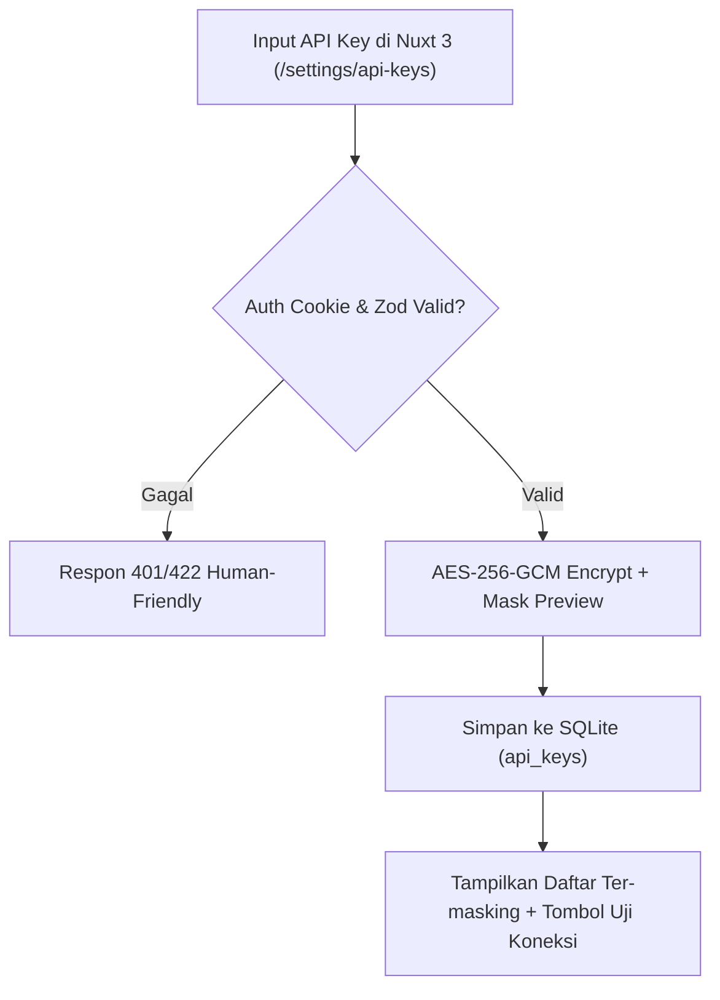

# Autentikasi Lokal & Brankas BYOK API Keys

> **Informasi Modul**: Route: `/login` & `/settings/api-keys` | Penanggung Jawab: **AhmadArifff** | Status: **`Done`** | Terakhir Diperbarui: **2026-11-26**

---

## 1. Ringkasan Eksekutif (3 Kalimat Inti)

1. **Fungsi Produk**: Melindungi akses studio lokal melalui akun pemilik serta menyediakan brankas aman untuk menyimpan dan menguji API Key AI milik pengguna (BYOK: Gemini, OpenAI, Claude, OpenRouter, Groq, Deepgram).
2. **Alur & Mesin Utama**: Kunci API dienkripsi di backend menggunakan `AES-256-GCM` sebelum masuk ke tabel `api_keys` SQLite, hanya dikembalikan dalam format ter-masking (`AIza...1234`), dan dapat diuji koneksinya secara langsung via adapter ping dengan batas waktu 8 detik.
3. **Dampak Nyata**: Pengguna bebas menggunakan kuota AI miliknya sendiri tanpa biaya langganan perantara serta terjamin bebas dari kebocoran kunci rahasia di UI, jaringan, maupun log server.

---

## 2. Core Flow & Topologi Arsitektur

### Alur Kerja Normal (Happy Path)
1. **Inisialisasi & Login (`/login`)**: Pada akses pertama kali, sistem mendeteksi `needsSetup = true` dan mengarahkan pembuatan akun pemilik lokal (`bcryptjs` cost 12 + `HttpOnly JWT Cookie`).
2. **Input BYOK (`/settings/api-keys`)**: Pengguna memilih penyedia AI, peran (`brain` / `stt` / `tts`), label penanda, model bawaan, lalu menempelkan kunci API.
3. **Validasi & Enkripsi**: Express memvalidasi payload via `CreateApiKeyInputSchema` (`@clip/shared`), mengenkripsi kunci dengan `encryptSecret()` (IV acak 12-byte + authTag 16-byte), lalu menyimpannya melalui `apiKeyRepository`.
4. **Uji Koneksi Live**: Saat pengguna menekan *Uji Koneksi*, backend mendekripsi sementara di RAM, memanggil `pingAiProvider()` (timeout 8s), menyimpan status `lastTestOk`, dan mengembalikan hasil ramah pengguna.

### Diagram Alir Proses (Mermaid)

### Peta Komponen Arsitektur
- **Frontend Pages**: `apps/web/pages/login.vue`, `apps/web/pages/settings/api-keys.vue`
- **Frontend Layout & Stores**: `apps/web/components/layout/StudioShell.vue`, `apps/web/components/shared/ThemeSwitcher.vue`, `apps/web/stores/auth.ts`, `apps/web/stores/theme.ts`
- **Shared Zod Contracts**: `packages/shared/src/index.ts` (`AuthSetupInputSchema`, `AuthLoginInputSchema`, `CreateApiKeyInputSchema`)
- **Backend Routes & Controllers**: `apps/api/src/routes/auth.routes.ts`, `apps/api/src/routes/api-key.routes.ts`, `apps/api/src/controllers/auth.controller.ts`, `apps/api/src/controllers/api-key.controller.ts`
- **Backend Services & Utils**: `apps/api/src/services/auth.service.ts`, `apps/api/src/services/api-key.service.ts`, `apps/api/src/services/ai/provider-ping.adapter.ts`, `apps/api/src/utils/crypto.ts`
- **Repositories**: `apps/api/src/repositories/user.repository.ts`, `apps/api/src/repositories/api-key.repository.ts`

---

## 3. Matriks Keterlibatan Basis Data & Storage Lokal

| Tabel Prisma / Storage | Kolom Kunci | Tipe Aksi | Skenario Alur | Keterangan & Logika Status |
| :--- | :--- | :--- | :--- | :--- |
| `users` | `id`, `email`, `name`, `password_hash`, `role` | `INSERT` / `SELECT` | **Core Flow** | Registrasi pemilik studio pertama & validasi login |
| `api_keys` | `provider`, `role`, `label`, `encrypted_key`, `iv`, `auth_tag`, `masked_preview`, `default_model` | `INSERT` | **Core Flow** | Simpan API key terenkripsi AES-256-GCM |
| `api_keys` | `last_tested_at`, `last_test_ok`, `is_active` | `UPDATE` | **Core Flow** | Catat hasil uji koneksi & toggle status aktif |
| `api_keys` | `id` | `DELETE` | **Core Flow** | Penghapusan permanen kunci milik user terkait |

---

## 4. Logika Bisnis, Keamanan & Validasi Kunci

1. **Auth Guard Global**: Seluruh endpoint `/api/api-keys/*` dan halaman `/settings/*` wajib melewati `requireAuth` (JWT `HttpOnly`, `SameSite=Lax`) dan `auth.global.ts`.
2. **Zero Plaintext Leak**: Query `apiKeyRepository.listByUser()` menggunakan `select` eksplisit yang mengecualikan `encryptedKey`, `iv`, dan `authTag`.
3. **Sanitasi Error & Log**: `sanitizeSecretFromText()` menyaring token `Bearer` dan query `?key=` sebelum pesan error dicatat atau dikembalikan.

---

## 5. Skenario Edge Cases & Celah Lapangan (*Field Edge-Case & Gap Audit*)

| No | Skenario Edge Case | Potensi Risiko Lapangan | Solusi & Penanganan Sistem |
| :---: | :--- | :--- | :--- |
| 1 | **User memanggil `/api/auth/setup` saat akun sudah ada** | Pengambilalihan akun lokal secara paksa. | Backend menolak dengan `409 SETUP_ALREADY_COMPLETED`. |
| 2 | **API Key invalid / kuota habis / internet mati saat Test Connection** | Request menggantung lama atau membocorkan `?key=...` di error stack. | Timeout ketat 8 detik + pesan ramah untuk HTTP 401/403/429 + sanitasi secret. |
| 3 | **Data ciphertext di SQLite dimodifikasi manual** | Dekripsi menghasilkan kunci rusak. | Mode `AES-256-GCM` memverifikasi `authTag` dan langsung menolak payload korup. |

---

## 6. Checklist Pengujian & Hasil yang Diharapkan (Smoke Test)

| ID Uji | Skenario Uji | Input Data | Hasil UI yang Diharapkan | Hasil DB / API yang Diharapkan |
| :--- | :--- | :--- | :--- | :--- |
| `TC-01` | Akses privat tanpa login | `GET /api/api-keys` tanpa cookie | Redirect ke `/login` | HTTP `401 UNAUTHORIZED` |
| `TC-02` | Setup akun & simpan kunci BYOK | Email valid + key `sk-proj-...6655` | Toast hijau, kartu tampil `sk-p...6655` | Baris `api_keys` terenkripsi, response bebas plaintext |
| `TC-03` | Switch 3 Tema Studio | Klik `Editing Room` / `Editorial` / `Tactile` | Shell layout, tipografi, warna & copywriting langsung berubah | Tersimpan di `localStorage` (`clip_studio_theme_v1`) |

---

## 7. Panduan Tanya-Jawab Cepat (*Operational Q&A*)

- **Pertanyaan:** *Apakah API Key saya ikut ter-upload ke GitHub?*
  - **Jawaban:** Tidak. Kunci disimpan terenkripsi di `storage/clip_content_rewards.db` dan kunci master berada di `.env`; keduanya diblokir oleh `.gitignore`.
- **Pertanyaan:** *Kombinasi kunci apa yang paling hemat untuk mulai?*
  - **Jawaban:** Pasang Google Gemini (`gemini-2.5-flash`) untuk peran *Otak Analisis* dan Groq (`whisper-large-v3-turbo`) untuk peran *Transkrip Kata Video*.

---

## 8. Riwayat Perubahan (*Changelog*)

| Tanggal | Commit Hash | Pengembang | Milestone | Ringkasan Perubahan & Dampak |
| :--- | :--- | :--- | :--- | :--- |
| 2026-11-26 | `HEAD` | AhmadArifff | **M4** | Implementasi awal Auth lokal, Brankas BYOK AES-256-GCM, Test Connection 6 provider, dan 3 Tema Switchable UI. |

---

## 9. Peta Alur & Flow Testing Per-Konten UI (*Button, Form & Switcher*)

### 9A. Matriks Keterlacakan Per-Konten

| No | Elemen UI & File Vue | Composable / Store | Endpoint HTTP | Rantai Fungsi Backend | Tabel DB Terdampak |
| :---: | :--- | :--- | :--- | :--- | :--- |
| **1** | **Form Setup / Login** `apps/web/pages/login.vue` | `useAuthStore().setupAdmin()` / `login()` | `POST /api/auth/setup`, `POST /api/auth/login` | `authController` -> `authService` -> `userRepository` | `users` (`INSERT` / `SELECT`) |
| **2** | **Form Tambah Kunci BYOK** `apps/web/pages/settings/api-keys.vue` | `apiRequest('/api/api-keys')` | `POST /api/api-keys` | `apiKeyController.create` -> `apiKeyService.createKey` -> `encryptSecret` -> `apiKeyRepository.create` | `api_keys` (`INSERT`) |
| **3** | **Tombol Uji Koneksi** `apps/web/pages/settings/api-keys.vue` | `apiRequest('/api/api-keys/:id/test')` | `POST /api/api-keys/:id/test` | `apiKeyController.testConnection` -> `apiKeyService.testConnection` -> `pingAiProvider` -> `apiKeyRepository.updateTestStatus` | `api_keys` (`UPDATE`: `last_tested_at`, `last_test_ok`) |
| **4** | **Theme Switcher 3 Gaya** `apps/web/components/shared/ThemeSwitcher.vue` | `useThemeStore().setTheme()` + `useThemeCopy()` | Client-side (`localStorage`) | N/A | N/A (`data-theme` DOM attribute) |

### 9B. Flow Testing Per-Konten dengan Ilustrasi Data Kasar

#### Konten 1: Form Tambah Kunci BYOK & Uji Koneksi
- **Kondisi Awal di Layar:** Bagian *Kunci Terpasang (0)* menampilkan panduan pasang 1 Brain + 1 Transkrip.
- **Langkah Uji:**
  1. Buka `/settings/api-keys`.
  2. Pilih Penyedia `Google Gemini`, Peran `Otak Analisis & Skor Viral`, isi Nama Penanda `"Gemini Utama"`, tempel API Key, klik tombol simpan.
  3. Klik tombol **`Uji Koneksi`** pada kartu kunci yang baru muncul.
- **Hasil UI yang Diharapkan:** Muncul notifikasi sukses, kartu menampilkan preview ter-masking (`AIza...xxxx`), lalu badge status berubah menjadi `Terhubung` atau `Gagal Uji` sesuai respons live penyedia.
- **Hasil DB yang Diharapkan:** Tabel `api_keys` bertambah 1 baris dengan kolom `encrypted_key`, `iv`, `auth_tag` terisi hex acak dan `last_tested_at` terisi timestamp ISO.

---

## 10. Disambiguasi Fitur Kembar & Batas Konteks Lintas-Menu

| Topik / Fitur Mirip | Yang Ditangani di Modul INI (`/settings/api-keys`) | Yang Berada di Modul LAIN (Jangan Tertukar!) | Perbedaan Kunci |
| :--- | :--- | :--- | :--- |
| **Koneksi AI Provider** | Penyimpanan terenkripsi, masking, dan ping koneksi dasar API Key. | Eksekusi prompt Brief Parser (`M5`), AI Director (`M6`), dan Re-Editor (`M8`). | Modul ini hanya mengelola kredensial & kesehatan koneksi, tidak mengirim transkrip/brief. |

- **Batas Tanggung Jawab Modul Ini:**
  - **BERTANGGUNG JAWAB ATAS:** Autentikasi sesi lokal, manajemen brankas BYOK terenkripsi, dan tampilan System Doctor di halaman pengaturan utama.
  - **TIDAK MENANGANI:** Pengolahan dokumen brief, upload video mentah, atau pemrosesan antrean render FFmpeg.
