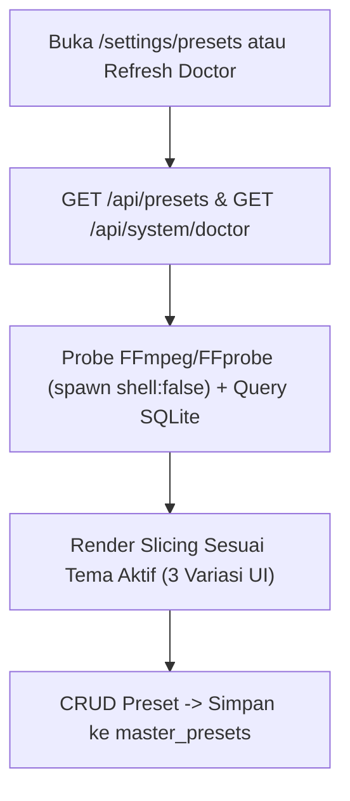

# Master Presets Dinamis & System Doctor

> **Informasi Modul**: Route: `/settings/presets` & `/api/system/doctor` | Penanggung Jawab: **AhmadArifff** | Status: **`Done`** | Terakhir Diperbarui: **2026-11-26**

---

## 1. Ringkasan Eksekutif (3 Kalimat Inti)

1. **Fungsi Produk**: Menyediakan manajemen data master dinamis (negara, rentang usia, gaya editing, tipe hook, tingkat kontroversi, mode framing 9:16, serta chip prompt cepat lapangan) bersama panel diagnostik kesehatan perangkat lokal (*System Doctor*).
2. **Alur & Mesin Utama**: Seluruh daftar preset disimpan di tabel `master_presets` dan `target_profiles` (nol data hardcode), sementara `doctorService` memeriksa binary `ffmpeg`/`ffprobe` via `spawn(..., { shell: false })`, mode SQLite WAL, ketersediaan font subtitle, dan kapasitas folder `storage/`.
3. **Dampak Nyata**: Kreator dapat langsung menambah preset lapangan favoritnya (seperti *"Mute Audio Asli 0%"* atau *"Kecilkan Audio 15%"*) tanpa mengubah kode, sekaligus mendeteksi kendala perangkat lokal sebelum memulai render batch.

---

## 2. Core Flow & Topologi Arsitektur

### Alur Kerja Normal (Happy Path)
1. **Diagnostik Startup & Live Check**: Saat server menyala, `initDatabaseAndRecoverJobs()` mengaktifkan mode `SQLite WAL` dan memulihkan `render_jobs` berstatus `processing` yang terhenti. Saat halaman dibuka, `GET /api/system/doctor` memindai `ffmpeg`, `ffprobe`, font, dan disk lokal.
2. **Filter & CRUD Master Presets (`/settings/presets`)**: Pengguna memilih tab kategori (misal *Preset Prompt Lapangan*), menambah preset baru (kode slug + label Bahasa Indonesia + instruksi prompt), mengaktifkan/menonaktifkan, atau menghapus preset.

### Diagram Alir Proses (Mermaid)

### Peta Komponen Arsitektur
- **Frontend Page & Component**: `apps/web/pages/settings/presets.vue`, `apps/web/components/studio/DoctorPanel.vue`
- **Shared Zod Contracts**: `packages/shared/src/index.ts` (`CreateMasterPresetInputSchema`, `UpdateMasterPresetInputSchema`, `CreateTargetProfileInputSchema`)
- **Backend Routes & Controllers**: `apps/api/src/routes/preset.routes.ts`, `apps/api/src/routes/system.routes.ts`, `apps/api/src/controllers/preset.controller.ts`
- **Backend Services & Seed**: `apps/api/src/services/preset.service.ts`, `apps/api/src/services/doctor.service.ts`, `apps/api/prisma/seed.ts`
- **Repository**: `apps/api/src/repositories/preset.repository.ts`

---

## 3. Matriks Keterlibatan Basis Data & Storage Lokal

| Tabel Prisma / Storage | Kolom Kunci | Tipe Aksi | Skenario Alur | Keterangan & Logika Status |
| :--- | :--- | :--- | :--- | :--- |
| `master_presets` | `category`, `code`, `label_id`, `config_json`, `sort_order`, `is_active` | `SELECT` / `INSERT` / `UPDATE` / `DELETE` | **Core Flow** | Manajemen preset dinamis lintas 7 kategori |
| `target_profiles` | `user_id`, `profile_name`, `target_config_json`, `is_default` | `SELECT` / `INSERT` / `DELETE` | **Core Flow** | Profil target audiens reusable multi-akun |
| `render_jobs` | `status`, `stage_label`, `error_message` | `UPDATE` | **Startup Recovery** | Pemulihan otomatis zombie job saat server restart |
| `storage/` | Ukuran folder lokal | `STAT` | **Core Flow** | Pelaporan ruang disk terpakai di System Doctor |

---

## 4. Logika Bisnis, Keamanan & Validasi Kunci

1. **Zero Hardcoded Master Data**: 37 preset awal (negara, usia, gaya edit, hook, kontroversi, framing, 9 preset prompt lapangan) di-seed melalui `prisma/seed.ts` menggunakan `upsert` idempoten.
2. **Keamanan Eksekusi Binary**: Pemeriksaan `ffmpeg` dan `ffprobe` wajib memakai `spawn(bin, ['-version'], { shell: false })` dengan timeout 5 detik.
3. **Unik Kategori + Kode**: Duplikasi pasangan `(category, code)` ditolak secara bersih dengan HTTP `409 PRESET_DUPLICATE`.

---

## 5. Skenario Edge Cases & Celah Lapangan (*Field Edge-Case & Gap Audit*)

| No | Skenario Edge Case | Potensi Risiko Lapangan | Solusi & Penanganan Sistem |
| :---: | :--- | :--- | :--- |
| 1 | **FFmpeg belum terpasang di PATH perangkat baru** | Proses render di M6 gagal tanpa sebab jelas. | `System Doctor` menandai status `Perlu Perhatian` dan menampilkan pesan binary tidak ditemukan. |
| 2 | **Duplikasi kode preset saat tambah manual** | Error unik database mentah muncul ke UI. | Service memeriksa kombinasi `(category, code)` dan mengembalikan pesan Bahasa Indonesia ramah. |
| 3 | **Laptop restart paksa saat job berjalan** | Antrean terjebak selamanya di status `processing`. | `initDatabaseAndRecoverJobs()` otomatis menandai job tersangkut agar bisa di-retry aman. |

---

## 6. Checklist Pengujian & Hasil yang Diharapkan (Smoke Test)

| ID Uji | Skenario Uji | Input Data | Hasil UI yang Diharapkan | Hasil DB / API yang Diharapkan |
| :--- | :--- | :--- | :--- | :--- |
| `TC-01` | Cek System Doctor | `GET /api/system/doctor` | Badge `Siap Produksi`, FFmpeg `8.1.2` & SQLite `WAL` terdeteksi | `ffmpeg.available: true`, `database.walMode: "wal"` |
| `TC-02` | Tambah Preset Prompt Lapangan | Kategori `prompt_preset`, kode `duck_10`, label `"Kecilkan Audio 10%"` | Preset langsung tampil di daftar & bisa di-toggle aktif/nonaktif | Baris baru tersimpan di `master_presets` |

---

## 7. Panduan Tanya-Jawab Cepat (*Operational Q&A*)

- **Pertanyaan:** *Apakah aman menonaktifkan preset bawaan yang jarang dipakai?*
  - **Jawaban:** Aman. Klik tombol `Aktif`/`Nonaktif` agar preset disembunyikan dari form Studio tanpa menghapus datanya secara permanen.

---

## 8. Riwayat Perubahan (*Changelog*)

| Tanggal | Commit Hash | Pengembang | Milestone | Ringkasan Perubahan & Dampak |
| :--- | :--- | :--- | :--- | :--- |
| 2026-11-26 | `HEAD` | AhmadArifff | **M4** | Implementasi awal CRUD `master_presets`, API `target_profiles`, seed 37 preset bawaan, dan System Doctor 3 tema. |

---

## 9. Peta Alur & Flow Testing Per-Konten UI (*Filter, Form & Toggle*)

### 9A. Matriks Keterlacakan Per-Konten

| No | Elemen UI & File Vue | Composable / API Client | Endpoint HTTP | Rantai Fungsi Backend | Tabel DB / Storage Terdampak |
| :---: | :--- | :--- | :--- | :--- | :--- |
| **1** | **Panel System Doctor & Tombol Periksa Ulang** `apps/web/components/studio/DoctorPanel.vue` | `apiRequest('/api/system/doctor')` | `GET /api/system/doctor` | `systemRouter` -> `doctorService.runCheck` | `master_presets`, `api_keys`, `storage/` (`SELECT`/`STAT`) |
| **2** | **Form Tambah Preset Dinamis** `apps/web/pages/settings/presets.vue` | `apiRequest('/api/presets')` | `POST /api/presets` | `presetController.createPreset` -> `presetService.createPreset` -> `presetRepository.createMasterPreset` | `master_presets` (`INSERT`) |
| **3** | **Tombol Toggle Aktif & Hapus Preset** `apps/web/pages/settings/presets.vue` | `apiRequest('/api/presets/:id')` | `PATCH /api/presets/:id`, `DELETE /api/presets/:id` | `presetController` -> `presetService` -> `presetRepository` | `master_presets` (`UPDATE` / `DELETE`) |

### 9B. Flow Testing Per-Konten dengan Ilustrasi Data Kasar

#### Konten 1: Tambah & Toggle Preset Prompt Lapangan
- **Kondisi Awal di Layar:** Tab `Preset Prompt Lapangan` menampilkan 9 preset bawaan (termasuk *Mute Audio Asli (0%)* dan *Kecilkan Audio Asli ke 15%*).
- **Langkah Uji:**
  1. Buka `/settings/presets`.
  2. Isi Kode `duck_audio_10`, Label `"Kecilkan Audio Asli ke 10%"`, Instruksi Prompt `"Turunkan volume asli ke 10% untuk lagu TikTok"`, klik **`Simpan Preset Baru`**.
  3. Klik tombol **`Aktif`** pada preset baru untuk mengubahnya menjadi **`Nonaktif`**.
- **Hasil UI yang Diharapkan:** Jumlah daftar preset bertambah 1, muncul notifikasi hijau, dan badge tombol berubah status.
- **Hasil DB yang Diharapkan:** Tabel `master_presets` memiliki baris baru dengan `code = 'duck_audio_10'` dan `is_active` berubah `true -> false`.

---

## 10. Disambiguasi Fitur Kembar & Batas Konteks Lintas-Menu

| Topik / Fitur Mirip | Yang Ditangani di Modul INI (`/settings/presets`) | Yang Berada di Modul LAIN (Jangan Tertukar!) | Perbedaan Kunci |
| :--- | :--- | :--- | :--- |
| **Master Presets & Prompt Lapangan** | Pengelolaan CRUD daftar preset (`master_presets`). | Konsumsi preset secara read-only di Campaign Studio (`M6`) dan Prompt Re-Editor (`M8`). | Modul ini mengubah daftar master, bukan menjalankan render video. |

- **Batas Tanggung Jawab Modul Ini:**
  - **BERTANGGUNG JAWAB ATAS:** Pengelolaan master preset dinamis, penyimpanan profil target audiens, serta pemeriksaan kesiapan perangkat lokal.
  - **TIDAK MENANGANI:** Eksekusi batch generate atau pemotongan video FFmpeg.
