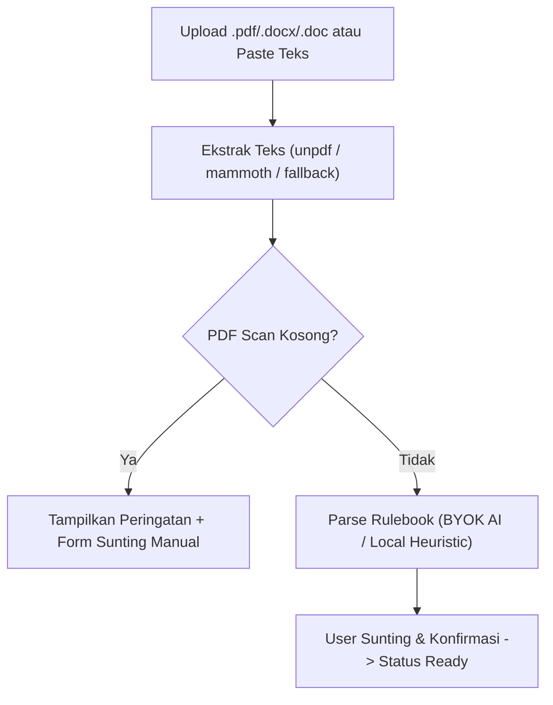

# Manajemen Campaign & Parser Brief (`.doc/.docx/.pdf`)

> **Informasi Modul**: Route: `/campaigns` & `/campaigns/:id/studio` | Penanggung Jawab: **AhmadArifff** | Status: **`Done`** | Terakhir Diperbarui: **2026-11-26**

---

## 1. Ringkasan Eksekutif (3 Kalimat Inti)

1. **Fungsi Produk**: Mengelola daftar campaign Content Rewards serta mengekstrak file brief pemilik campaign (`.pdf`, `.docx`, `.doc`, `.txt`, atau paste teks) menjadi *Brief Rulebook* terstruktur.
2. **Alur & Mesin Utama**: Dokumen dibaca lewat `unpdf` (`.pdf`), `mammoth` (`.docx`), dan ekstraktor teks fallback (`.doc`), lalu diterjemahkan ke kontrak `BriefRulebookSchema` melalui BYOK AI (`llm-json.adapter.ts`) dengan fallback ekstraktor heuristik lokal bila kunci AI belum dipasang.
3. **Dampak Nyata**: Kreator dapat menyunting dan mengonfirmasi syarat wajib (*Do's*), larangan (*Don'ts*), hashtag, mention, serta batas durasi sebelum men-generate variasi video agar terhindar dari penolakan payout campaign.

---

## 2. Core Flow & Topologi Arsitektur

### Alur Kerja Normal (Happy Path)
1. User membuat campaign baru di `/campaigns` (judul, pemilik brand, target platform TikTok/YT Shorts/YT Long, catatan reward/CPM).
2. Di `/campaigns/:id/studio`, user mengunggah berkas brief atau menempelkan teks brief lalu menekan *Ekstrak Aturan Brief Otomatis*.
3. Backend mengekstrak teks mentah, mendeteksi apakah PDF merupakan hasil scan gambar kosong (`< 30` karakter), lalu menghasilkan `BriefRulebook` tervalidasi Zod.
4. User meninjau, menyunting bila perlu, lalu menekan *Konfirmasi Aturan Brief* sehingga status campaign berpindah `draft -> ready`.

### Diagram Alir Proses (Mermaid)


### Peta Komponen Arsitektur
- **Frontend Pages**: `apps/web/pages/campaigns/index.vue`, `apps/web/pages/campaigns/[id]/studio.vue`
- **Shared Zod Contracts**: `packages/shared/src/index.ts` (`CreateCampaignInputSchema`, `BriefRulebookSchema`, `UpdateBriefRulebookInputSchema`)
- **Backend Routes & Controller**: `apps/api/src/routes/campaign.routes.ts`, `apps/api/src/controllers/campaign.controller.ts`
- **Backend Services**: `apps/api/src/services/campaign.service.ts`, `apps/api/src/services/brief-parser.service.ts`, `apps/api/src/services/ai/llm-json.adapter.ts`
- **Repository**: `apps/api/src/repositories/campaign.repository.ts`

---

## 3. Matriks Keterlibatan Basis Data & Storage Lokal

| Tabel Prisma / Storage | Kolom / File Kunci | Tipe Aksi | Skenario Alur | Keterangan & Logika Status |
| :--- | :--- | :--- | :--- | :--- |
| `campaigns` | `title`, `brand_owner`, `platform_targets_json`, `reward_notes`, `status` | `INSERT` / `UPDATE` / `DELETE` | **Core Flow** | CRUD campaign & transisi `draft -> ready` |
| `campaign_briefs` | `source_type`, `original_filename`, `stored_file_path`, `raw_text`, `parsed_rulebook_json`, `confirmed_by_user` | `UPSERT` / `UPDATE` | **Core Flow** | Simpan berkas & rulebook terstruktur |
| `storage/uploads/<campaignId>/briefs/` | `<uuid>.(pdf|docx|doc|txt)` | `WRITE` / `DELETE` | **Core Flow** | Isolasi berkas brief per campaign + cleanup saat delete |

---

## 4. Logika Bisnis, Keamanan & Validasi Kunci

1. **Whitelist Ekstensi & Batas Ukuran**: Hanya mengizinkan `.pdf`, `.docx`, `.doc`, `.txt` maksimal `20 MB` dengan penamaan UUID terisolasi di dalam `storage/`.
2. **Validasi Zod Mutlak**: Seluruh hasil ekstraksi AI maupun suntingan manual user wajib lolos `BriefRulebookSchema`.
3. **Graceful Fallback**: Jika user belum memasang API Key `brain` atau API AI sedang timeout, sistem otomatis mengalihkan ke `buildHeuristicRulebook()` lokal agar workflow tidak pernah buntu.

---

## 5. Skenario Edge Cases & Celah Lapangan (*Field Edge-Case & Gap Audit*)

| No | Skenario Edge Case | Potensi Risiko Lapangan | Solusi & Penanganan Sistem |
| :---: | :--- | :--- | :--- |
| 1 | **File `.pdf` berupa hasil scan gambar** | Ekstraksi teks kosong membuat rulebook gagal. | Deteksi `rawText.length < 30`, munculkan banner peringatan ramah + form sunting manual langsung terbuka. |
| 2 | **Campaign dihapus saat sudah memiliki file brief & video** | Meninggalkan file yatim berukuran besar di disk lokal. | `campaignService.deleteCampaign()` menghapus record relasi cascade sekaligus `fs.rmSync(storage/uploads/<campaignId>)`. |
| 3 | **BYOK LLM mengembalikan markdown ```json ... ```** | `JSON.parse` gagal. | `extractJsonObject()` mengekstrak blok JSON bersih sebelum divalidasi Zod. |

---

## 6. Checklist Pengujian & Hasil yang Diharapkan (Smoke Test)

| ID Uji | Skenario Uji | Input Data | Hasil UI yang Diharapkan | Hasil DB / API yang Diharapkan |
| :--- | :--- | :--- | :--- | :--- |
| `TC-01` | Buat campaign & ekstrak teks brief | Teks berisi `#BrandE2E`, `@brande2e`, `20-45 detik` | Form Rulebook terisi otomatis `#BrandE2E`, min `20`, max `45` | Baris `campaigns` & `campaign_briefs` tersimpan |
| `TC-02` | Konfirmasi aturan brief | Edit tone -> klik *Konfirmasi Aturan Brief* | Badge `Terkonfirmasi` muncul | `confirmed_by_user = true`, `campaigns.status = 'ready'` |

---

## 7. Panduan Tanya-Jawab Cepat (*Operational Q&A*)

- **Pertanyaan:** *Apakah saya harus punya API Key dulu hanya untuk mengunggah brief?*
  - **Jawaban:** Tidak wajib untuk mencoba; ekstraktor lokal tetap membaca hashtag, mention, durasi, dan poin wajib/larangan yang bisa langsung Anda sunting. Memasang kunci Gemini/OpenAI akan membuat ekstraksi jauh lebih mendalam.

---

## 8. Riwayat Perubahan (*Changelog*)

| Tanggal | Commit Hash | Pengembang | Milestone | Ringkasan Perubahan & Dampak |
| :--- | :--- | :--- | :--- | :--- |
| 2026-11-26 | `HEAD` | AhmadArifff | **M5** | Implementasi CRUD Campaign, parser `.pdf/.docx/.doc`/teks, BYOK LLM JSON adapter, heuristic fallback, & Editable Brief Rulebook UI (3 tema). |

---

## 9. Peta Alur & Flow Testing Per-Konten UI

### 9A. Matriks Keterlacakan Per-Konten

| No | Elemen UI & File Vue | Composable / API Client | Endpoint HTTP | Rantai Fungsi Backend | Tabel DB / Storage Terdampak |
| :---: | :--- | :--- | :--- | :--- | :--- |
| **1** | **Form Buat Campaign Baru**<br>`apps/web/pages/campaigns/index.vue` | `apiRequest('/api/campaigns')` | `POST /api/campaigns` | `campaignController.create` -> `campaignService.createCampaign` -> `campaignRepository.create` | `campaigns` (`INSERT`) |
| **2** | **Upload / Paste Brief & Tombol Ekstrak**<br>`apps/web/pages/campaigns/[id]/studio.vue` | `fetch('/api/campaigns/:id/brief/upload')` | `POST /api/campaigns/:id/brief/upload` | `campaignController.uploadBrief` -> `campaignService.uploadOrParseBrief` -> `brief-parser.service` | `campaign_briefs` (`UPSERT`), `storage/uploads/` |
| **3** | **Form Editable Rulebook & Konfirmasi**<br>`apps/web/pages/campaigns/[id]/studio.vue` | `apiRequest('/api/campaigns/:id/brief')` | `PATCH /api/campaigns/:id/brief` | `campaignController.updateBrief` -> `campaignService.updateBriefRulebook` | `campaign_briefs` (`UPDATE`), `campaigns` (`UPDATE`) |

### 9B. Flow Testing Per-Konten dengan Ilustrasi Data Kasar

#### Konten 1: Ekstrak & Konfirmasi Brief Campaign
- **Kondisi Awal di Layar:** Halaman `/campaigns/:id/studio` menampilkan kotak upload brief dan status `Lengkapi Brief & Video Mentah`.
- **Langkah Uji:** Tempel teks brief berisi `#BrandE2E`, `@brande2e`, `20-45 detik` -> klik **`Ekstrak Aturan Brief Otomatis`** -> periksa field `#rb-tags` -> klik **`Konfirmasi Aturan Brief`**.
- **Hasil UI yang Diharapkan:** Field hashtag terisi `#BrandE2E`, badge berubah `Terkonfirmasi`.
- **Hasil DB yang Diharapkan:** `campaign_briefs.confirmed_by_user = 1` dan `campaigns.status = 'ready'`.

---

## 10. Disambiguasi Fitur Kembar & Batas Konteks Lintas-Menu

| Topik / Fitur Mirip | Yang Ditangani di Modul INI (`/campaigns`) | Yang Berada di Modul LAIN | Perbedaan Kunci |
| :--- | :--- | :--- | :--- |
| **Penyuntingan Teks** | Menyunting aturan global campaign (`BriefRulebook`). | Menyunting typo subtitle pada 1 klip spesifik (`M8` Inline Subtitle Editor). | Modul ini mengatur syarat payout campaign, bukan teks subtitle per detik. |

- **Batas Tanggung Jawab Modul Ini:**
  - **BERTANGGUNG JAWAB ATAS:** Siklus hidup Campaign dan ekstraksi/konfirmasi aturan Brief.
  - **TIDAK MENANGANI:** Pemotongan video FFmpeg atau penilaian skor viral per klip.
