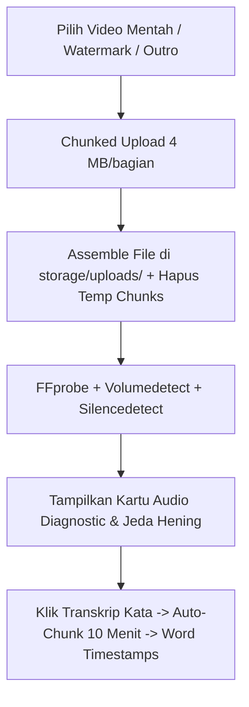

# Raw Video Ingestion, Supporting Assets, Audio Diagnostic & Chunked Transcript

> **Informasi Modul**: Route: `/campaigns/:id/studio` (Panel 2) | Penanggung Jawab: **AhmadArifff** | Status: **`Done`** | Terakhir Diperbarui: **2026-11-26**

---

## 1. Ringkasan Eksekutif (3 Kalimat Inti)

1. **Fungsi Produk**: Mengunggah video mentah berukuran besar (hingga 2 GB) beserta *Supporting Assets* (logo/watermark PNG, bumper outro, B-roll) dengan dukungan pemeriksaan metadata otomatis, diagnosa audio, peta jeda hening, dan transkripsi kata per detik.
2. **Alur & Mesin Utama**: Browser memotong file per `4 MB` via `useChunkedUploader()`, backend menggabungkannya ke `storage/uploads/<campaignId>/media/`, menjalankan `ffprobe` + 1-pass `volumedetect`/`silencedetect`, serta memecah audio per `10 menit` (overlap `2s`, ~4.8 MB/chunk) saat transkripsi BYOK STT agar kebal batas 25 MB API Whisper.
3. **Dampak Nyata**: Kreator bisa langsung mengolah rekaman podcast/stream >1 jam tanpa gagal upload maupun gagal batas API, sekaligus langsung mendapat saran mode audio (*Original*, *Ducking 20%*, atau *Mute 0%* untuk sound TikTok/YouTube).

---

## 2. Core Flow & Topologi Arsitektur

### Alur Kerja Normal (Happy Path)
1. User memilih jenis berkas (`raw_video`, `watermark`, `outro`, atau `broll`) dan memilih file lokal di Panel 2 Studio.
2. `useChunkedUploader()` mengirim potongan 4 MB secara berurutan ke `POST /api/campaigns/:id/media/chunk` sambil memperbarui progress bar real-time.
3. Setelah seluruh potongan terkirim, frontend memanggil `POST /api/campaigns/:id/media/complete` yang menggabungkan file, memverifikasi via `ffprobe`, menghitung **Audio Diagnostic** & **Silence Intervals**, lalu menyimpan baris `media_assets`.
4. Untuk video mentah berdialog, user dapat menekan *Transkrip Kata (AI)* (`POST /api/media/:mediaId/transcribe`) guna menjalankan auto-chunked Whisper/Deepgram STT.

### Diagram Alir Proses (Mermaid)

### Peta Komponen Arsitektur
- **Frontend Composable & View**: `apps/web/composables/useChunkedUploader.ts`, `apps/web/pages/campaigns/[id]/studio.vue`
- **Shared Zod Contracts**: `packages/shared/src/index.ts` (`CompleteChunkUploadInputSchema`, `AudioDiagnosticSchema`, `TranscriptPayloadSchema`)
- **Backend Routes & Controller**: `apps/api/src/routes/media.routes.ts`, `apps/api/src/controllers/media.controller.ts`
- **Backend Services**: `apps/api/src/services/media.service.ts`, `apps/api/src/services/media/media-probe.service.ts`, `apps/api/src/services/ai/stt.adapter.ts`
- **Repository**: `apps/api/src/repositories/media.repository.ts`

---

## 3. Matriks Keterlibatan Basis Data & Storage Lokal

| Tabel Prisma / Storage | Kolom / File Kunci | Tipe Aksi | Skenario Alur | Keterangan & Logika Status |
| :--- | :--- | :--- | :--- | :--- |
| `media_assets` | `asset_type`, `file_path`, `duration_sec`, `width`, `height`, `fps`, `has_audio`, `audio_diagnostic_json`, `silences_json` | `INSERT` | **Core Flow** | Registrasi media terverifikasi FFprobe |
| `media_assets` | `transcript_json`, `status`, `error_message` | `UPDATE` | **Core Flow** | Simpan hasil word-level transcript & status |
| `storage/temp/chunks_*` | `part_00000..part_NNNNN` | `WRITE` / `DELETE` | **Temp** | Potongan sementara dibersihkan otomatis di blok `finally` |
| `storage/uploads/<campaignId>/media/` | `<uuid>.(mp4|mov|png|...)` | `WRITE` / `DELETE` | **Core Flow** | Penyimpanan permanen media lokal |

---

## 4. Logika Bisnis, Keamanan & Validasi Kunci

1. **Anti Shell-Injection FFmpeg/FFprobe**: Seluruh panggilan `ffprobe` dan `ffmpeg` menggunakan `spawn(bin, argsArray, { shell: false })` dengan path hasil `resolveSafeStoragePath()`.
2. **Audio Diagnostic Otomatis**:
   - `hasAudio = false` atau `meanVolumeDb < -52 dB` -> menyarankan `mute_for_platform_sound`.
   - `meanVolumeDb > -12 dB` -> menyarankan `ducking_20` (indikasi musik latar padat).
   - Selainnya -> menyarankan `original_normalized` (`-14 LUFS`).
3. **Auto-Chunking STT > 1 Jam**: Audio diekstrak mono 16kHz 64kbps MP3 per `600 detik` (overlap `2 detik`) sehingga setiap chunk ~4.8 MB (aman jauh di bawah batas 25 MB Groq/OpenAI Whisper) dengan deduplikasi kata pada zona overlap.

---

## 5. Skenario Edge Cases & Celah Lapangan (*Field Edge-Case & Gap Audit*)

| No | Skenario Edge Case | Potensi Risiko Lapangan | Solusi & Penanganan Sistem |
| :---: | :--- | :--- | :--- |
| 1 | **Video mentah bisu (Visual-Only / B-Roll)** | Proses STT gagal atau crash. | `probeMediaAsset()` mendeteksi `hasAudio = false`, langsung set `transcript.mode = 'visual_only'` dan menyarankan *Mute 0%*. |
| 2 | **Upload terputus (chunk hilang)** | File video gabungan korup. | `completeChunkedUpload()` memverifikasi keberadaan seluruh `part_0..N-1`; bila kurang, file batal dibuat dan folder temp dibersihkan. |
| 3 | **User klik Transkrip sebelum pasang API Key STT** | Error mentah tidak jelas. | Mengembalikan `400 STT_KEY_MISSING` berbahasa Indonesia ramah yang mengarahkan ke menu Brankas API. |

---

## 6. Checklist Pengujian & Hasil yang Diharapkan (Smoke Test)

| ID Uji | Skenario Uji | Input Data | Hasil UI yang Diharapkan | Hasil DB / File yang Diharapkan |
| :--- | :--- | :--- | :--- | :--- |
| `TC-01` | Chunked upload MP4 (2 potongan) | Video MP4 uji 4 detik + jeda hening | Progress 0%->100%, muncul kartu video + Diagnosa Audio + jumlah jeda hening | 1 file di `storage/uploads/.../media/`, temp chunk terhapus, `media_assets` terisi |
| `TC-02` | Upload watermark PNG | Gambar `.png` 128x64 | Muncul pada bagian *Supporting Assets* dengan badge `WATERMARK` | Baris `media_assets` dengan `asset_type = 'watermark'` |

---

## 7. Panduan Tanya-Jawab Cepat (*Operational Q&A*)

- **Pertanyaan:** *Berapa ukuran maksimal video mentah yang bisa diunggah?*
  - **Jawaban:** Hingga `2 GB` per berkas berkat sistem chunked upload `4 MB` per potongan sehingga memori browser maupun server lokal tetap ringan.

---

## 8. Riwayat Perubahan (*Changelog*)

| Tanggal | Commit Hash | Pengembang | Milestone | Ringkasan Perubahan & Dampak |
| :--- | :--- | :--- | :--- | :--- |
| 2026-11-26 | `HEAD` | AhmadArifff | **M5** | Implementasi chunked upload, FFprobe, 1-pass Audio Diagnostic & Silence Detect, Supporting Assets, serta Auto-Chunked STT Adapter. |

---

## 9. Peta Alur & Flow Testing Per-Konten UI

### 9A. Matriks Keterlacakan Per-Konten

| No | Elemen UI & File Vue | Composable / API Client | Endpoint HTTP | Rantai Fungsi Backend | Tabel DB / Storage Terdampak |
| :---: | :--- | :--- | :--- | :--- | :--- |
| **1** | **Input File Media & Jenis Berkas** `apps/web/pages/campaigns/[id]/studio.vue` | `useChunkedUploader().uploadMediaFile()` | `POST /api/campaigns/:id/media/chunk` -> `POST /api/campaigns/:id/media/complete` | `mediaController` -> `mediaService` -> `probeMediaAsset()` -> `mediaRepository.create` | `media_assets` (`INSERT`), `storage/uploads/` |
| **2** | **Tombol Transkrip Kata (AI)** `apps/web/pages/campaigns/[id]/studio.vue` | `apiRequest('/api/media/:id/transcribe')` | `POST /api/media/:mediaId/transcribe` | `mediaController.transcribe` -> `mediaService.transcribeAsset` -> `transcribeMediaWithAutoChunking` | `media_assets` (`UPDATE`: `transcript_json`) |
| **3** | **Tombol Hapus Media / Asset** `apps/web/pages/campaigns/[id]/studio.vue` | `apiRequest('/api/media/:id')` | `DELETE /api/media/:mediaId` | `mediaController.remove` -> `mediaService.deleteAsset` | `media_assets` (`DELETE`), hapus file fisik |

### 9B. Flow Testing Per-Konten dengan Ilustrasi Data Kasar

#### Konten 1: Chunked Upload Video Mentah & Diagnosa Audio
- **Kondisi Awal di Layar:** Bagian *Video Mentah (0)* kosong; badge atas menampilkan `Lengkapi Brief & Video Mentah`.
- **Langkah Uji:** Pilih jenis `Video Mentah Utama`, pilih berkas `sample-raw-m5.mp4` di `#media-file`.
- **Hasil UI yang Diharapkan:** Progress bar mencapai `100%`, kartu `sample-raw-m5.mp4` tampil bersama blok **Diagnosa Audio** dan rekomendasi mode audio, serta badge header berubah `Bahan Lengkap (Siap Generator M6)`.
- **Hasil DB / File yang Diharapkan:** 1 baris `media_assets` (`status = 'ready'`, `duration_sec > 0`, `audio_diagnostic_json` valid) dan folder `storage/temp/chunks_*` sudah bersih.

---

## 10. Disambiguasi Fitur Kembar & Batas Konteks Lintas-Menu

| Topik / Fitur Mirip | Yang Ditangani di Modul INI (`/campaigns/:id/studio`) | Yang Berada di Modul LAIN | Perbedaan Kunci |
| :--- | :--- | :--- | :--- |
| **Audio Mode** | Mendiagnosa audio video mentah & memberi **saran rekomendasi** sebelum generate. | Mengatur volume/mute batch (`M6`) atau mengubah volume 1 klip spesifik via prompt (`M8`). | Modul ini bersifat diagnostik (read-only pada video mentah), tidak memodifikasi file mentah. |

- **Batas Tanggung Jawab Modul Ini:**
  - **BERTANGGUNG JAWAB ATAS:** Unggahan media mentah/pendukung, verifikasi FFprobe, diagnosa audio, peta jeda hening, dan transkripsi kata.
  - **TIDAK MENANGANI:** Rendering potongan video klip atau scoring viral.
