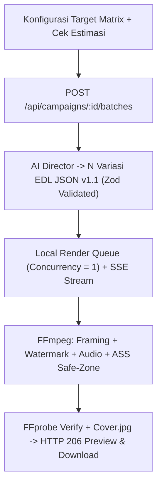

# Target Audience Matrix & Multi-Variant AI Auto-Editor

> **Informasi Modul**: Route: `/campaigns/:id/studio` (Tahap 3) & `/campaigns/:id/batches/:batchId` | Penanggung Jawab: **AhmadArifff** | Status: **`Done`** | Terakhir Diperbarui: **2026-11-26**

---

## 1. Ringkasan Eksekutif (3 Kalimat Inti)

1. **Fungsi Produk**: Memungkinkan kreator mengonfigurasi target audiens dan strategi viral secara lengkap (negara, usia, persona, tingkat kontroversi, tipe hook 3 detik, framing 9:16, mode audio awal, profil akun reusable) lalu men-generate hingga 10 variasi video sekaligus secara otomatis.
2. **Alur & Mesin Utama**: AI Director merancang banyak rencana edit deterministik (`EDL JSON v1.1`) yang dieksekusi oleh antrean render lokal SQLite (`MAX_RENDER_CONCURRENCY=1`) menggunakan FFmpeg 8.1.2, ASS Safe-Zone Captions/Hook Banner, dan live progress SSE (`/api/batches/:batchId/stream`).
3. **Dampak Nyata**: Kreator dapat mencetak batch variasi video `1080x1920` (atau `16:9`) gratis tanpa biaya server cloud, dengan dukungan audio Mute `0%` (`anullsrc` AAC valid), Ducking `20%`, maupun Normalized `-14 LUFS`, serta pemutaran preview cepat berbasis HTTP `206 Partial Content`.

---

## 2. Core Flow & Topologi Arsitektur

### Alur Kerja Normal (Happy Path)
1. Di Tahap 3 Studio (`/campaigns/:id/studio`), user mengisi parameter target audiens (atau memuat 1-klik dari *Target Profile* tersimpan) lalu klik *Cek Estimasi* untuk melihat perkiraan token & durasi render.
2. User klik *Generate X Variasi* (`POST /api/campaigns/:id/batches`) -> backend membuat record `generation_batches` dan memasukkan tugas ke `renderQueueWorker`.
3. Halaman berpindah ke `/campaigns/:id/batches/:batchId` yang membuka koneksi SSE `/api/batches/:batchId/stream` untuk menampilkan progres real-time per klip.
4. Worker menjalankan AI Director (`edl-director.service.ts`) -> merender tiap klip melalui `edl-renderer.service.ts` (`subtitles.ass`, `subtitles.srt`, `video.mp4`, `cover.jpg`) -> verifikasi post-render via `ffprobe` -> tampil siap putar & unduh.

### Diagram Alir Proses (Mermaid)

### Peta Komponen Arsitektur
- **Frontend Components & Pages**: `apps/web/components/studio/TargetGeneratorPanel.vue`, `apps/web/pages/campaigns/[id]/studio.vue`, `apps/web/pages/campaigns/[id]/batches/[batchId].vue`
- **Backend Routes & Controller**: `apps/api/src/routes/batch.routes.ts`, `apps/api/src/controllers/batch.controller.ts`
- **Backend Services & Worker**: `apps/api/src/services/batch.service.ts`, `apps/api/src/services/ai/edl-director.service.ts`, `apps/api/src/services/media/ass-subtitle.builder.ts`, `apps/api/src/services/media/edl-renderer.service.ts`, `apps/api/src/workers/render-queue.worker.ts`
- **Repository**: `apps/api/src/repositories/batch.repository.ts`

---

## 3. Matriks Keterlibatan Basis Data & Storage Lokal

| Tabel Prisma / Storage | Kolom / File Kunci | Tipe Aksi | Skenario Alur | Keterangan & Logika Status |
| :--- | :--- | :--- | :--- | :--- |
| `generation_batches` | `target_config_json`, `batch_diversity_mode`, `requested_count`, `status`, `estimated_tokens`, `actual_tokens` | `INSERT` / `UPDATE` | **Core Flow** | Transisi `queued -> processing -> completed/partial_success/failed/cancelled` |
| `clips` & `clip_versions` | `angle_title`, `edl_json`, `output_video_path`, `output_srt_path`, `cover_image_path`, `actual_duration_sec` | `INSERT` / `UPDATE` | **Core Flow** | Simpan rencana EDL & hasil render `v1` |
| `render_jobs` | `job_type`, `entity_id`, `status`, `progress_pct`, `stage_label` | `INSERT` / `UPDATE` | **Core Flow** | Persistent queue lokal & pemulihan zombie job saat restart |
| `storage/renders/<batchId>/<clipId>/v1/` | `video.mp4`, `subtitles.ass`, `subtitles.srt`, `cover.jpg` | `WRITE` | **Core Flow** | Output video 1080x1920 H.264/AAC siap upload |

---

## 4. Logika Bisnis, Keamanan & Validasi Kunci

1. **Windows Path Escaping Safe (`cwd`)**: FFmpeg dijalankan dengan `cwd: absDir` dan filter `ass=subtitles.ass` tanpa path absolut huruf drive `C:\` agar 100% stabil di Windows.
2. **Audio Mute Valid (`anullsrc`)**: Pada mode `mute_for_platform_sound`, FFmpeg tetap menulis trek AAC stereo hening 48kHz agar file tidak ditolak oleh parser TikTok/YouTube/iOS.
3. **Clamp Durasi EDL**: Setiap `startSec`/`endSec` divalidasi dan di-clamp terhadap `mediaAsset.durationSec` aktual sebelum merender.
4. **HTTP `206 Partial Content`**: Endpoint `/api/clips/:clipId/stream-video` mendukung header `Range` penuh agar scrubbing player video berjalan mulus.

---

## 5. Skenario Edge Cases & Celah Lapangan (*Field Edge-Case & Gap Audit*)

| No | Skenario Edge Case | Potensi Risiko Lapangan | Solusi & Penanganan Sistem |
| :---: | :--- | :--- | :--- |
| 1 | **Video sumber 16:9 berisi teks di pinggir layar** | Center crop ke 9:16 memotong teks penting. | Mode default `fit_blur_bg` menjaga seluruh lebar 16:9 utuh di tengah latar blur 9:16; tersedia pula `center_crop` dan `split_screen`. |
| 2 | **User belum memasang kunci AI `brain` saat uji lokal** | Generator gagal total. | `edl-director.service.ts` menyediakan fallback perencana heuristik lokal yang tetap membentuk multi-varian EDL tervalidasi Zod. |
| 3 | **1 dari 5 variasi gagal render** | Seluruh batch sia-sia. | Status batch menjadi `partial_success`; variasi yang sukses tetap siap tonton/unduh dan variasi gagal memiliki tombol *Retry Klip Ini*. |

---

## 6. Checklist Pengujian & Hasil yang Diharapkan (Smoke Test)

| ID Uji | Skenario Uji | Input Data | Hasil UI yang Diharapkan | Hasil DB / Media yang Diharapkan |
| :--- | :--- | :--- | :--- | :--- |
| `TC-01` | Render batch 2 variasi `fit_blur_bg` + `mute_for_platform_sound` | Raw video 16:9 4-5 detik | Progress SSE mencapai `100% COMPLETED`, 2 player MP4 siap putar | `ffprobe` memverifikasi `1080x1920`, `hasAudio: true`, `meanVolumeDb < -60 dB` |
| `TC-02` | HTTP Range Streaming `bytes=0-1023` | `GET /api/clips/:id/stream-video` | Video scrubbing instan di browser | HTTP `206 Partial Content` + header `Content-Range` valid |

---

## 7. Panduan Tanya-Jawab Cepat (*Operational Q&A*)

- **Pertanyaan:** *Mengapa render berjalan 1 video per waktu di laptop?*
  - **Jawaban:** Batas `MAX_RENDER_CONCURRENCY=1` melindungi CPU dan RAM laptop agar tidak hang saat menghasilkan 5-10 variasi sekaligus.

---

## 8. Riwayat Perubahan (*Changelog*)

| Tanggal | Commit Hash | Pengembang | Milestone | Ringkasan Perubahan & Dampak |
| :--- | :--- | :--- | :--- | :--- |
| 2026-11-26 | `HEAD` | AhmadArifff | **M6** | Implementasi Target Audience Matrix, Reusable Target Profiles, AI Director EDL Planner, Local Queue + SSE, FFmpeg 9:16 Safe-Zone Renderer & Range Streaming. |

---

## 9. Peta Alur & Flow Testing Per-Konten UI

### 9A. Matriks Keterlacakan Per-Konten

| No | Elemen UI & File Vue | Composable / Client | Endpoint HTTP | Rantai Fungsi Backend | Tabel DB / Storage Terdampak |
| :---: | :--- | :--- | :--- | :--- | :--- |
| **1** | **Tombol Cek Estimasi** `apps/web/components/studio/TargetGeneratorPanel.vue` | `apiRequest('/api/campaigns/:id/batches/estimate')` | `POST /api/campaigns/:id/batches/estimate` | `batchController.estimate` -> `batchService.estimate` -> `estimateBatchCost` | `campaigns`, `media_assets` (`SELECT`) |
| **2** | **Tombol Generate X Variasi** `apps/web/components/studio/TargetGeneratorPanel.vue` | `apiRequest('/api/campaigns/:id/batches')` | `POST /api/campaigns/:id/batches` | `batchController.start` -> `batchService.startBatch` -> `renderQueueWorker.enqueueBatch` | `generation_batches`, `clips`, `clip_versions`, `render_jobs`, `storage/renders/` |
| **3** | **Live Progress Bar & Video Player** `apps/web/pages/campaigns/[id]/batches/[batchId].vue` | `EventSource('/api/batches/:id/stream')` + `<video src>` | `GET /api/batches/:id/stream`, `GET /api/clips/:id/stream-video` | `batchController.streamProgress`, `batchController.streamVideo` | `render_jobs` (`SELECT`), stream MP4 `206` |

### 9B. Flow Testing Per-Konten dengan Ilustrasi Data Kasar

#### Konten 1: Generate 2 Variasi 9:16 Mode Mute 0%
- **Kondisi Awal di Layar:** Campaign memiliki 1 video mentah 16:9 (`sample-raw-m6.mp4`).
- **Langkah Uji:** Pilih Mode Audio `Mute Total 0%`, Framing `Fit-Width + Latar Blur`, Jumlah Variasi `2` -> klik **`Cek Estimasi`** -> klik **`Generate 2 Variasi`**.
- **Hasil UI yang Diharapkan:** Redirect ke `/campaigns/:id/batches/:batchId`, progress SSE bergerak hingga `100% | Status: COMPLETED`, tampil 2 kartu video dengan badge `Mute 0% (Sound Platform)` dan tombol `Unduh MP4`.
- **Hasil DB / Media yang Diharapkan:** 2 file `video.mp4` (`1080x1920`), `subtitles.ass`, `subtitles.srt`, dan `cover.jpg` terbentuk di `storage/renders/<batchId>/`.

---

## 10. Disambiguasi Fitur Kembar & Batas Konteks Lintas-Menu

| Topik / Fitur Mirip | Yang Ditangani di Modul INI (`/batches/:batchId`) | Yang Berada di Modul LAIN | Perbedaan Kunci |
| :--- | :--- | :--- | :--- |
| **Mode Audio (Mute / Ducking)** | Setting awal serentak untuk seluruh variasi dalam 1 batch (`initialAudioMode`). | Mengubah audio hanya pada 1 klip spesifik lewat prompt (`M8` Prompt Re-Editor -> `v2`). | Batch generator membuat `v1` untuk semua klip; Re-Editor hanya mem-patch 1 klip. |

- **Batas Tanggung Jawab Modul Ini:**
  - **BERTANGGUNG JAWAB ATAS:** Perencanaan multi-varian EDL, antrean render FFmpeg lokal, streaming progres SSE, dan preview hasil batch.
  - **TIDAK MENANGANI:** Penilaian skor viral 6 dimensi/playbook rinci (`M7`), patching prompt per klip (`M8`), atau bulk ZIP streaming (`M9`).
