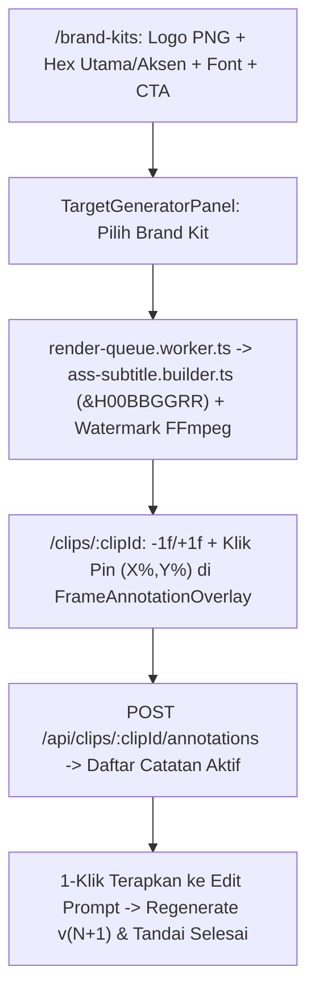

# Frame-by-Frame Visual Annotation & Brand Asset Kit Reusable

> **Informasi Modul**: Route: `/brand-kits` (Pustaka Brand Kit) & `/clips/:clipId` (Overlay Pin Frame + Toolbar `-1f`/`+1f`) | Penanggung Jawab: **AhmadArifff** | Status: **`Done`** | Terakhir Diperbarui: **2026-11-28**

---

## 1. Ringkasan Eksekutif (3 Kalimat Inti)

1. **Fungsi Produk**: Memungkinkan kreator menandai revisi langsung di atas frame video pada detik dan koordinat `(X%, Y%)` persis (*Frame-by-Frame Visual Annotation* ala `motlab`) serta mengelola **Brand Asset Kit** reusable (*logo PNG, warna hex utama/aksen, font subtitle, posisi watermark, dan CTA wajib* ala `motlab-assets`) agar seluruh video dalam satu merek tampil seragam.
2. **Alur & Mesin Utama**: `FrameAnnotationOverlay.vue` menangkap koordinat klik saat `Mode Pin Frame` aktif dan menyimpannya ke `clip_annotations` untuk dikompilasi 1 klik ke Tab Edit Prompt, sementara `BrandAssetKit` disuntikkan langsung oleh `render-queue.worker.ts` & `ass-subtitle.builder.ts` (konversi `#RRGGBB` -> `&H00BBGGRR`) beserta logo watermark ke proses render FFmpeg.
3. **Dampak Nyata**: Revisi video menjadi seakurat menunjuk layar langsung tanpa salah detik, dan identitas visual klien/merek terjaga otomatis dari video pertama hingga ke-100 tanpa mengatur ulang logo maupun warna.

---

## 2. Core Flow & Topologi Arsitektur

### Alur Kerja Normal (Happy Path)
1. **Pustaka Brand Asset Kit (`/brand-kits`)**: User membuat kit baru dengan nama merek, warna utama & aksen (`#RRGGBB`), font subtitle lokal, posisi/opasitas watermark, template CTA, dan mengunggah logo PNG/JPG/WebP sambil melihat **Pratinjau Live Overlay 9:16**.
2. **Penerapan Otomatis di Studio Campaign**: Di `TargetGeneratorPanel.vue`, user memilih Brand Kit pada dropdown **`Brand Asset Kit`** -> saat batch dirender, worker otomatis menempelkan logo kit (jika belum ada watermark manual), mewarnai Hook Banner, Subtitle Bold, dan CTA di berkas `subtitles.ass`, serta mengisi teks CTA bawaan.
3. **Pin Catatan Frame di Clip Inspector (`/clips/:clipId`)**: User melangkah frame dengan **`-1f`** / **`+1f`**, mengaktifkan **`Pin Catatan Frame`**, mengklik titik spesifik di atas video, menyimpan catatan (`POST /api/clips/:clipId/annotations`), lalu mengklik **`Terapkan ke Edit Prompt`** agar seluruh pin aktif otomatis dirangkai menjadi prompt revisi di Tab Edit Prompt.

### Diagram Alir Proses (Mermaid)

### Peta Komponen Arsitektur
- **Shared Schema**: `packages/shared/src/index.ts` (`HexColorSchema`, `CreateClipAnnotationInputSchema`, `CreateBrandKitInputSchema`, `brandKitId` pada `TargetConfig` & `SupportingOverlays`)
- **Database Prisma**: `apps/api/prisma/schema.prisma` (`ClipAnnotation`, `BrandAssetKit`)
- **Backend Services & Routes**: `apps/api/src/services/annotation.service.ts`, `brand-kit.service.ts`, `apps/api/src/controllers/annotation.controller.ts`, `brand-kit.controller.ts`, `apps/api/src/routes/m15.routes.ts`, `apps/api/src/services/media/ass-subtitle.builder.ts`
- **Frontend UI**: `apps/web/pages/brand-kits.vue`, `apps/web/components/studio/FrameAnnotationOverlay.vue`, `apps/web/pages/clips/[clipId].vue`, `apps/web/components/studio/TargetGeneratorPanel.vue`

---

## 3. Matriks Keterlibatan Basis Data & Storage Lokal

| Tabel Prisma / Storage | Kolom / File Kunci | Tipe Aksi | Skenario Alur | Keterangan & Logika Status |
| :--- | :--- | :--- | :--- | :--- |
| `clip_annotations` | `clip_id`, `timestamp_sec`, `x_pct`, `y_pct`, `category`, `note_text`, `status` | `INSERT` / `SELECT` / `UPDATE` / `DELETE` | **Pin Catatan Frame** | Cascade otomatis saat klip/campaign dihapus |
| `brand_asset_kits` | `name`, `primary_color_hex`, `accent_color_hex`, `caption_font_family`, `logo_file_path`, `default_cta_template` | `INSERT` / `SELECT` / `UPDATE` / `DELETE` | **Brand Asset Kit** | Terikat ketat pada `user_id` pemilik studio |
| `storage/brand-kits/<kitId>/` | `logo.png` / `logo.jpg` / `logo.webp` | `WRITE` / `READ` / `DELETE` | **Logo Brand Kit** | Terproteksi `resolveSafeStoragePath()`, otomatis terhapus saat kit dihapus |

---

## 4. Logika Bisnis, Keamanan & Validasi Kunci

1. **Validasi MIME & Ukuran Logo**: Upload logo hanya mengizinkan `image/png`, `image/jpeg`, `image/webp` maksimal `5 MB` via `multer.memoryStorage()`; tipe lain ditolak `400 INVALID_LOGO_FORMAT`.
2. **Konversi Warna ASS Aman (`hexToAssColor`)**: Input hex divalidasi regex ketat `^#[0-9A-Fa-f]{6}$` lalu dibalik dari `RRGGBB` ke format ASS `BBGGRR` (`#E11D48` -> `&H00481DE1`) sehingga tidak pernah menghasilkan berkas `.ass` rusak.
3. **Isolasi Event Klik Video vs Pin Mode**: `FrameAnnotationOverlay.vue` memakai `pointer-events-none` saat `pinMode === false` agar kontrol pemutar `<video>` native berjalan mulus tanpa terhalang, dan beralih ke `cursor-crosshair` hanya saat `pinMode === true`.
4. **Higienitas File Saat Hapus Kit**: Menghapus Brand Kit otomatis membersihkan direktori fisik `storage/brand-kits/<kitId>/` agar tidak menyisakan file yatim.

---

## 5. Skenario Edge Cases & Celah Lapangan (*Field Edge-Case & Gap Audit*)

| No | Skenario Edge Case | Potensi Risiko Lapangan | Solusi & Penanganan Sistem |
| :---: | :--- | :--- | :--- |
| 1 | **User mengunggah file teks/PDF ke input logo Brand Kit** | FFmpeg error saat overlay watermark. | Backend menolak dengan `400 INVALID_LOGO_FORMAT` sebelum menulis ke disk. |
| 2 | **User memilih Brand Kit sekaligus mengunggah watermark khusus campaign** | Konflik dua gambar watermark. | Watermark spesifik campaign tetap diprioritaskan; logo Brand Kit berlaku otomatis sebagai fallback yang rapi bila watermark campaign kosong. |
| 3 | **Banyak pin di beberapa detik berbeda pada satu klip** | Layar video penuh titik pin yang menutupi preview. | Pin yang jauh dari playhead (`> 0.7s`) disembunyikan saat playback normal dan hanya tampil saat mendekati detiknya atau saat `Mode Pin` aktif. |

---

## 6. Checklist Pengujian & Hasil yang Diharapkan (Smoke Test)

| ID Uji | Skenario Uji | Input Data | Hasil UI yang Diharapkan | Hasil DB / Media yang Diharapkan |
| :--- | :--- | :--- | :--- | :--- |
| `TC-01` | Buat Brand Kit (`#E11D48`, `#F59E0B`, `Arial`) + Upload Logo PNG + Generate Klip | `POST /api/brand-kits`, `POST /logo`, `POST /batches` | Kartu kit + pratinjau logo muncul; kit tampil di dropdown Studio | `subtitles.ass` memuat `&H00481DE1`, `&H000B9EF5`, `Arial`, & CTA kit; `ffprobe` MP4 `1080x1920` |
| `TC-02` | Frame-step `+1f` + Klik Pin `(45%, 65%)` + Kompilasi ke Edit Prompt | `POST /api/clips/:id/annotations` | Pin bernomor muncul di atas video, kartu `1 Aktif` tampil, Tab Edit Prompt terisi teks pin | Baris tersimpan di `clip_annotations`, dapat di-resolve (`PATCH`) dan dihapus (`DELETE`) |

---

## 7. Panduan Tanya-Jawab Cepat (*Operational Q&A*)

- **Pertanyaan:** *Apakah warna Brand Kit langsung terlihat pada video MP4 hasil unduhan?*
  - **Jawaban:** Ya. Warna utama diterapkan pada latar Hook Banner & CTA Penutup, sedangkan warna aksen diterapkan pada teks Subtitle Bold di `subtitles.ass` dan di-burn langsung ke MP4 oleh FFmpeg.

---

## 8. Riwayat Perubahan (*Changelog*)

| Tanggal | Commit Hash | Pengembang | Milestone | Ringkasan Perubahan & Dampak |
| :--- | :--- | :--- | :--- | :--- |
| 2026-11-28 | `HEAD` | AhmadArifff | **M15 (V2)** | Penambahan model `ClipAnnotation` & `BrandAssetKit`, konversi warna ASS `hexToAssColor`, integrasi watermark/CTA/font Brand Kit di worker & renderer, overlay pin frame + kontrol `-1f`/`+1f` di `/clips/:clipId`, dan halaman `/brand-kits` (3 tema + mobile). |

---

## 9. Peta Alur & Flow Testing Per-Konten UI

### 9A. Matriks Keterlacakan Per-Konten

| No | Elemen UI & File Vue | Composable / Client | Endpoint HTTP | Rantai Fungsi Backend | Tabel DB / Storage Terdampak |
| :---: | :--- | :--- | :--- | :--- | :--- |
| **1** | **Form & Daftar Brand Asset Kit** `apps/web/pages/brand-kits.vue` | `apiRequest('/api/brand-kits')` & `fetch('/logo')` | `GET/POST/PATCH/DELETE /api/brand-kits`, `POST/GET /logo` | `brandKitController` -> `brandKitService` | `brand_asset_kits`, `storage/brand-kits/<id>/` |
| **2** | **Overlay Pin & Daftar Catatan Frame** `FrameAnnotationOverlay.vue` & `[clipId].vue` | `apiRequest('/api/clips/:clipId/annotations')` | `GET/POST /clips/:clipId/annotations`, `PATCH/DELETE /annotations/:id` | `annotationController` -> `annotationService` | `clip_annotations` |

### 9B. Flow Testing Per-Konten dengan Ilustrasi Data Kasar

#### Konten 1: Brand Kit -> Studio Generate -> Frame Pin -> Kompilasi Prompt
- **Kondisi Awal di Layar:** Halaman `/brand-kits` kosong.
- **Langkah Uji:** Buat kit `Kopi Nusantara M15` (`#E11D48` / `#F59E0B` / `Arial`) + unggah logo PNG -> buat campaign & upload video 4s -> pilih `Kopi Nusantara M15` di dropdown Brand Kit -> generate 1 variasi -> buka Clip Inspector -> klik `+1f` -> aktifkan `Pin Catatan Frame` -> klik video -> simpan catatan -> klik `Terapkan ke Edit Prompt`.
- **Hasil UI yang Diharapkan:** Logo tampil di kartu Brand Kit, pin muncul di frame, dan kotak `#regen-prompt` otomatis terisi catatan pin beserta timestamp & koordinat `(X%, Y%)`.
- **Hasil DB / Media yang Diharapkan:** `subtitles.ass` memuat kode warna `&H00481DE1` & `&H000B9EF5`, dan `clip_annotations` menyimpan koordinat presisi.

---

## 10. Disambiguasi Fitur Kembar & Batas Konteks Lintas-Menu

| Topik / Fitur Mirip | Yang Ditangani di Modul INI (M15 Pin Frame & Brand Kit) | Yang Berada di Modul LAIN | Perbedaan Kunci |
| :--- | :--- | :--- | :--- |
| **Watermark Per Campaign vs Logo Brand Kit** | Logo reusable lintas campaign lengkap dengan warna ASS, font, dan CTA default (`/brand-kits`). | Upload supporting asset watermark satu kali khusus 1 campaign (`/campaigns/:id/studio`, `M5`). | Brand Kit menghindari upload & setting ulang di setiap campaign baru. |
| **Kritik AI vs Catatan Pin Frame** | Catatan manual presisi milik kreator/klien yang dipin langsung ke koordinat `(X%, Y%)` frame video. | Kritik otomatis hasil evaluasi 6 dimensi AI (`M7`). | Keduanya dapat dikirim 1 klik ke Tab `Edit Prompt` (`M8`) untuk dirender ke `v(N+1)`. |

- **Batas Tanggung Jawab Modul Ini:**
  - **BERTANGGUNG JAWAB ATAS:** Pin anotasi frame-by-frame per klip dan pengelolaan kit identitas visual reusable (logo, warna ASS, font, CTA).
  - **TIDAK MENANGANI:** Penjadwalan kalender & export `.xlsx` (`M14`) maupun deteksi posisi wajah auto-crop (`M13`).
