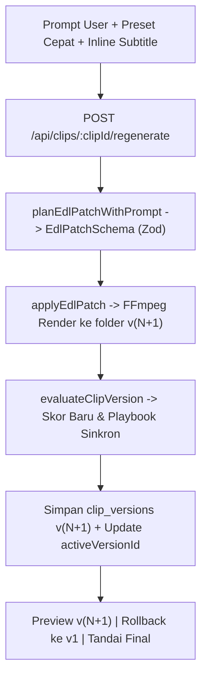

# Iterative Prompt Re-Editor, Inline Subtitle & Clip Versioning

> **Informasi Modul**: Route: `/clips/:clipId` (Tab Edit Ulang + Panel Riwayat Versi & Rollback) | Penanggung Jawab: **AhmadArifff** | Status: **`Done`** | Terakhir Diperbarui: **2026-11-26**

---

## 1. Ringkasan Eksekutif (3 Kalimat Inti)

1. **Fungsi Produk**: Memungkinkan kreator mengedit ulang **hanya 1 video spesifik** menggunakan prompt bahasa alami, kombinasi Preset Cepat Lapangan dari `master_presets` (seperti *Mute Audio Asli 0%* atau *Kecilkan Audio 15%* untuk sound musik TikTok/YouTube), maupun koreksi teks subtitle secara inline.
2. **Alur & Mesin Utama**: `edl-patcher.service.ts` menerjemahkan instruksi menjadi `EdlPatchSchema` tervalidasi Zod, menggabungkannya dengan EDL versi aktif via `applyEdlPatch()`, merender ulang berkas baru di folder `v(N+1)` via FFmpeg 8.1.2, lalu otomatis menghitung ulang Viral Score dan menyinkronkan Upload Playbook.
3. **Dampak Nyata**: Revisi video berjalan cepat tanpa mengulang seluruh batch dan tanpa menimpa versi sebelumnya, lengkap dengan riwayat versi (`v1`, `v2`, `v3`), perbandingan delta skor, tombol **Rollback ke Versi Sebelumnya**, serta penanda **Final** untuk tahap export.

---

## 2. Core Flow & Topologi Arsitektur

### Alur Kerja Normal (Happy Path)
1. Di `/clips/:clipId`, user membuka Tab **Edit Ulang** (atau klik tombol 1-klik **Perbaiki dengan Prompt** dari salah satu kartu kritik di Tab Skor & Kritik).
2. User memilih 1 atau beberapa chip **Preset Cepat Lapangan** (dimuat dinamis dari `GET /api/presets?category=prompt_preset&active=true`), menambahkan instruksi bebas pada kotak prompt, dan bila perlu membuka **Editor Teks Subtitle Inline** untuk memperbaiki typo.
3. User klik **Regenerate Versi v(N+1)** (`POST /api/clips/:clipId/regenerate`) -> backend mem-patch EDL -> FFmpeg merender `storage/renders/<batchId>/<clipId>/v(N+1)/` -> evaluator menghitung ulang skor & menyinkronkan Upload Playbook -> versi baru otomatis menjadi aktif.
4. User dapat membandingkan versi lama vs baru di panel **Riwayat Versi**, melakukan **Rollback** (`PATCH /api/clips/:clipId/active-version`), dan menandai klip sebagai **Final** (`PATCH /api/clips/:clipId/approve`).

### Diagram Alir Proses (Mermaid)

### Peta Komponen Arsitektur
- **Frontend Page**: `apps/web/pages/clips/[clipId].vue`
- **Backend Routes & Controller**: `apps/api/src/routes/clip.routes.ts`, `apps/api/src/controllers/clip.controller.ts`
- **Backend Services**: `apps/api/src/services/ai/edl-patcher.service.ts`, `apps/api/src/services/clip.service.ts`, `apps/api/src/services/media/edl-renderer.service.ts`, `apps/api/src/services/media/ass-subtitle.builder.ts`
- **Shared Zod Contract**: `EdlPatchSchema` di `packages/shared/src/index.ts`

---

## 3. Matriks Keterlibatan Basis Data & Storage Lokal

| Tabel Prisma / Storage | Kolom / File Kunci | Tipe Aksi | Skenario Alur | Keterangan & Logika Status |
| :--- | :--- | :--- | :--- | :--- |
| `clip_versions` | `version_number`, `user_prompt`, `applied_presets_json`, `edl_json`, `output_video_path`, `viral_score_total`, `upload_playbook_json` | `INSERT` | **Core Flow** | Setiap regenerate selalu menambah baris baru (`v2`, `v3`), tidak pernah menimpa `v1` |
| `clips` | `active_version_id`, `is_approved`, `status` | `UPDATE` | **Core Flow / Rollback** | Mengarahkan versi aktif terbaru atau rollback ke versi pilihan |
| `master_presets` | `category = 'prompt_preset'` | `SELECT` | **Core Flow** | Sumber dinamis 9 chip Preset Cepat Lapangan |
| `storage/renders/<batchId>/<clipId>/v(N+1)/` | `video.mp4`, `subtitles.ass`, `subtitles.srt`, `cover.jpg` | `WRITE` | **Core Flow** | Terisolasi per nomor versi agar rollback langsung siap putar tanpa render ulang |

---

## 4. Logika Bisnis, Keamanan & Validasi Kunci

1. **Non-Destructive Versioning**: Folder render tiap versi dipisah (`v1/`, `v2/`, `v3/`) dan `GET /api/clips/:clipId/stream-video?versionId=...` menyajikan file versi terpilih sehingga user bisa bolak-balik membandingkan hasil video sebelum dan sesudah edit secara instan.
2. **Proteksi Instruksi Kosong**: Controller menolak request regenerate jika `userPrompt`, `presetCodes`, dan `subtitleOverrides` ketiganya kosong (`400 EMPTY_REGENERATE_INSTRUCTION`).
3. **Preservasi Override & Audio Preset**: Meskipun user menggunakan BYOK AI LLM untuk patcher, `edl-patcher.service.ts` menjamin `subtitleOverrides` manual dan patch audio eksplisit tidak pernah hilang atau tertimpa respons AI.
4. **Verifikasi Fisik Audio Mute/Ducking**: Perubahan prompt mute (`0%`) mengaktifkan filter `anullsrc` stereo AAC 48kHz (`meanVolumeDb < -60 dB` terverifikasi `ffprobe`), sementara ducking `15%`/`30%` menerapkan `loudnorm` + `volume`.

---

## 5. Skenario Edge Cases & Celah Lapangan (*Field Edge-Case & Gap Audit*)

| No | Skenario Edge Case | Potensi Risiko Lapangan | Solusi & Penanganan Sistem |
| :---: | :--- | :--- | :--- |
| 1 | **Suara asli video belum sesuai brief karena akan diganti sound TikTok/YouTube** | User harus membuka software editing manual dari awal. | 1-klik preset *"Mute Audio Asli (0%) - Ganti Sound TikTok/YT"* atau *"Kecilkan Audio Asli ke 15%"* langsung merender `v2` dan mengubah instruksi mixing di Upload Playbook. |
| 2 | **Typo nama brand pada subtitle hasil transkrip STT** | Meminta AI memperbaiki typo lewat prompt sering tidak tepat sasaran. | Tersedia **Editor Teks Subtitle Inline** yang memetakan perubahan langsung ke `edl.captions.overrides` dan `subtitles.ass`/`subtitles.srt`. |
| 3 | **Hasil revisi `v2` ternyata tidak lebih bagus dari `v1`** | Hasil lama hilang jika file ditimpa. | Klik `v1` di panel Riwayat Versi lalu klik **Jadikan Versi Aktif (Rollback)** tanpa perlu merender ulang. |

---

## 6. Checklist Pengujian & Hasil yang Diharapkan (Smoke Test)

| ID Uji | Skenario Uji | Input Data | Hasil UI yang Diharapkan | Hasil DB / Media yang Diharapkan |
| :--- | :--- | :--- | :--- | :--- |
| `TC-01` | Regenerate `v1 -> v2` dengan prompt Mute Audio TikTok + Naikkan Subtitle | `presetCodes: ['mute_original_audio']` + prompt naikkan subtitle | Toast `Versi v2 selesai dirender`, badge `Mute 0% (Sound Platform)`, Playbook berubah ke `Audio Asli Di-Mute Penuh (0%)` | `clip_versions` bertambah `v2`; `ffprobe` pada `v2/video.mp4` memverifikasi `meanVolumeDb < -60 dB`; `verticalOffsetPct === 66` |
| `TC-02` | Rollback ke `v1` lalu Tandai Final | `PATCH /active-version` (`v1.id`) + `PATCH /approve` (`true`) | Badge `Aktif` berpindah ke `v1` dan tombol berubah menjadi `Ditandai Final` | `clips.active_version_id === v1.id` dan `clips.is_approved === true` |

---

## 7. Panduan Tanya-Jawab Cepat (*Operational Q&A*)

- **Pertanyaan:** *Apakah saya bisa menambah preset prompt cepat buatan sendiri?*
  - **Jawaban:** Ya. Buka menu **Preset Parameter** (`/settings/presets`), pilih kategori `prompt_preset`, lalu tambahkan preset baru; tombol preset tersebut otomatis muncul di Tab Edit Ulang.

---

## 8. Riwayat Perubahan (*Changelog*)

| Tanggal | Commit Hash | Pengembang | Milestone | Ringkasan Perubahan & Dampak |
| :--- | :--- | :--- | :--- | :--- |
| 2026-11-26 | `HEAD` | AhmadArifff | **M8** | Implementasi Iterative Prompt Re-Editor (`edl-patcher.service.ts`), 9 Preset Cepat dinamis, Inline Subtitle Editor, Non-Destructive Versioning (`v1..vN`), Rollback, dan Approval Final. |

---

## 9. Peta Alur & Flow Testing Per-Konten UI

### 9A. Matriks Keterlacakan Per-Konten

| No | Elemen UI & File Vue | Composable / Client | Endpoint HTTP | Rantai Fungsi Backend | Tabel DB / Storage Terdampak |
| :---: | :--- | :--- | :--- | :--- | :--- |
| **1** | **Chip Preset Cepat Lapangan** `apps/web/pages/clips/[clipId].vue` | `apiRequest('/api/presets?category=prompt_preset&active=true')` | `GET /api/presets` | `presetController.list` -> `presetService.list` | `master_presets` (`SELECT`) |
| **2** | **Tombol Regenerate Versi v(N+1)** `apps/web/pages/clips/[clipId].vue` | `apiRequest('/api/clips/:clipId/regenerate')` | `POST /api/clips/:clipId/regenerate` | `clipController.regenerate` -> `clipService.regenerateClip` -> `planEdlPatchWithPrompt` -> `renderEdlToMp4` -> `evaluateClipVersion` | `clip_versions` (`INSERT`), `clips` (`UPDATE`), `storage/renders/.../v(N+1)/` |
| **3** | **Tombol Rollback & Tandai Final** `apps/web/pages/clips/[clipId].vue` | `apiRequest('/api/clips/:clipId/active-version' \| '/approve')` | `PATCH /api/clips/:clipId/active-version`, `PATCH /api/clips/:clipId/approve` | `clipController.setActiveVersion`, `clipController.setApproval` -> `clipService` | `clips` (`UPDATE`) |

### 9B. Flow Testing Per-Konten dengan Ilustrasi Data Kasar

#### Konten 1: Regenerate `v1` (Original 100%) -> `v2` (Mute 0%) & Rollback
- **Kondisi Awal di Layar:** Halaman `/clips/:clipId` menampilkan `v1` dengan audio `Original 100% (-14 LUFS)`.
- **Langkah Uji:** Buka Tab **`Edit Ulang`** -> klik chip **`Mute Audio Asli (0%) - Ganti Sound TikTok/YT`** -> klik **`Regenerate Versi v2`** -> setelah selesai cek Tab **`Upload Playbook`** -> klik kartu **`v1`** di Riwayat Versi -> klik **`Jadikan Versi Aktif (Rollback)`** -> klik **`Tandai Final`**.
- **Hasil UI yang Diharapkan:** `v2` selesai dirender, badge berubah ke `Mute 0% (Sound Platform)`, Playbook menampilkan `Audio Asli Di-Mute Penuh (0%)`, rollback mengembalikan status `Aktif` ke `v1`, dan tombol approval berubah ke `Ditandai Final`.
- **Hasil DB / Media yang Diharapkan:** Folder `v1/` dan `v2/` keduanya utuh di `storage/renders/`; `v2/video.mp4` hening secara fisik (`< -60 dB`).

---

## 10. Disambiguasi Fitur Kembar & Batas Konteks Lintas-Menu

| Topik / Fitur Mirip | Yang Ditangani di Modul INI (`/clips/:clipId` Tab Edit Ulang) | Yang Berada di Modul LAIN | Perbedaan Kunci |
| :--- | :--- | :--- | :--- |
| **Pengaturan Audio / Framing / CTA** | Mengubah hanya **1 klip spesifik** dan menyimpan hasil sebagai versi baru (`v2`, `v3`). | Konfigurasi awal seluruh variasi sekaligus di Target Matrix `/campaigns/:id/studio` (`M6`). | Re-Editor menargetkan perbaikan presisi per klip berdasarkan kritik tanpa mengulang batch. |

- **Batas Tanggung Jawab Modul Ini:**
  - **BERTANGGUNG JAWAB ATAS:** Prompt patching EDL, penerapan Preset Cepat Lapangan, Inline Subtitle Overrides, rendering non-destruktif `v(N+1)`, Rollback, dan Approval Final.
  - **TIDAK MENANGANI:** Generate awal multi-varian batch (`M6`) maupun pengemasan export bulk ZIP (`M9`).
