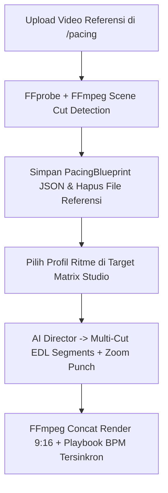

# Reference Video Pacing Cloner (Style-Only Rhythm & Tempo Extractor)

> **Informasi Modul**: Route: `/pacing` (Pustaka Ritme Referensi) & `/campaigns/:id/studio` (Dropdown Kloning Ritme pada Target Matrix) | Penanggung Jawab: **AhmadArifff** | Status: **`Done`** | Terakhir Diperbarui: **2026-11-28**

---

## 1. Ringkasan Eksekutif (3 Kalimat Inti)

1. **Fungsi Produk**: Memungkinkan kreator mengunggah 1 video viral referensi untuk mengekstrak ritme potongan (*scene cuts*), panjang tiap shot, kurva energi, serta estimasi tempo BPM menjadi profil ritme reusable tanpa pernah menyalin footage atau karakter video referensi.
2. **Alur & Mesin Utama**: `pacing-analyzer.service.ts` menjalankan FFprobe & FFmpeg `select='gt(scene,0.28)',showinfo` secara lokal, mengonversinya menjadi `PacingBlueprintSchema` tervalidasi Zod, segera menghapus file video referensi sementara, lalu menerapkannya pada `edl-director.service.ts` dan `viral-evaluator.service.ts`.
3. **Dampak Nyata**: Video mentah campaign Anda otomatis dipotong menjadi rangkaian *multi-cut* dinamis lengkap dengan aksen zoom dan sinkronisasi rentang BPM pada Upload Playbook, mengikuti ritme video viral yang telah terbukti menjaga retensi penonton.

---

## 2. Core Flow & Topologi Arsitektur

### Alur Kerja Normal (Happy Path)
1. User membuka menu **Ritme Referensi** (`/pacing`), mengisi nama profil opsional, memilih video referensi (`.mp4/.mov/.mkv/.webm`), lalu menekan **Analisis & Ekstrak Ritme** (`POST /api/pacing-profiles/analyze`).
2. Backend memvalidasi video via `ffprobe`, mendeteksi titik pergantian adegan via FFmpeg, membangun `PacingBlueprint` (shots, `cutsPerMinute`, `estimatedBpm`, `energyCurve`), menyimpannya ke tabel `reference_pacing_profiles`, dan langsung menghapus file referensi sementara dari `storage/temp/`.
3. Di Studio Campaign (`/campaigns/:id/studio`), user memilih profil ritme tersebut pada dropdown **Kloning Ritme Video Referensi** lalu menekan *Generate Variasi*.
4. `render-queue.worker.ts` meneruskan `PacingBlueprint` ke `edl-director.service.ts` (memecah video mentah campaign menjadi beberapa segmen potongan dengan durasi & zoom proporsional) dan `viral-evaluator.service.ts` (menyelaraskan rekomendasi BPM di Upload Playbook).

### Diagram Alir Proses (Mermaid)

### Peta Komponen Arsitektur
- **Frontend**: `apps/web/pages/pacing/index.vue`, `apps/web/components/layout/StudioShell.vue`, `apps/web/components/studio/TargetGeneratorPanel.vue`
- **Backend Routes & Controller**: `apps/api/src/routes/pacing.routes.ts`, `apps/api/src/controllers/pacing.controller.ts`
- **Backend Services & Repo**: `apps/api/src/services/media/pacing-analyzer.service.ts`, `apps/api/src/services/pacing.service.ts`, `apps/api/src/repositories/pacing.repository.ts`, `apps/api/src/services/ai/edl-director.service.ts`, `apps/api/src/services/ai/viral-evaluator.service.ts`, `apps/api/src/workers/render-queue.worker.ts`

---

## 3. Matriks Keterlibatan Basis Data & Storage Lokal

| Tabel Prisma / Storage | Kolom / File Kunci | Tipe Aksi | Skenario Alur | Keterangan & Logika Status |
| :--- | :--- | :--- | :--- | :--- |
| `reference_pacing_profiles` | `name`, `shot_count`, `avg_shot_duration_sec`, `cuts_per_minute`, `estimated_bpm`, `energy_curve`, `pacing_blueprint_json` | `INSERT` / `SELECT` / `DELETE` | **Core Flow** | Menyimpan pola ritme reusable per user (hanya metadata matematis) |
| `storage/temp/` | Berkas upload video referensi sementara | `WRITE` -> `DELETE` | **Style-Only Guardrail** | Langsung dihapus di blok `finally` sesaat setelah analisis selesai |

---

## 4. Logika Bisnis, Keamanan & Validasi Kunci

1. **Style-Only Cloning Guardrail**: Video referensi mentah dihapus otomatis lewat `fs.rmSync(..., { force: true })` pada blok `finally` di `pacing.service.ts` sehingga tidak ada footage/frame/audio pihak ketiga yang disimpan maupun disalin.
2. **One-Take Video Fallback**: Jika video referensi hanya memiliki `< 2` scene cut pada threshold `0.28`, analyzer mencoba threshold `0.14`, dan jika tetap one-take statis akan menyusun ritme *micro-zoom pulse* setiap ~2.2 detik agar tetap menghasilkan variasi gerak yang rapi.
3. **Proporsional Scaling & Clamping**: Saat diterapkan ke video mentah campaign, durasi shot dari referensi diskalakan proporsional ke durasi target klip (minimal `0.45s` per segmen, maksimal 8 cut per klip) agar hasil FFmpeg concat selalu mulus dan aman dari error durasi.
4. **Isolasi Kepemilikan User**: `referencePacingId` selalu diperiksa dengan `findByIdForUser(id, userId)` sebelum digunakan oleh worker maupun saat dihapus.

---

## 5. Skenario Edge Cases & Celah Lapangan (*Field Edge-Case & Gap Audit*)

| No | Skenario Edge Case | Potensi Risiko Lapangan | Solusi & Penanganan Sistem |
| :---: | :--- | :--- | :--- |
| 1 | **Berkas rusak atau file teks diganti ekstensi `.mp4`** | FFmpeg crash atau menyimpan profil rusak. | `ffprobe` memverifikasi keberadaan video stream & durasi `>= 1.0s`; bila gagal langsung hapus temp dan kirim `400 INVALID_REFERENCE_VIDEO`. |
| 2 | **Video referensi one-take (tanpa potongan adegan)** | Hasil ekstraksi hanya 1 shot datar tanpa manfaat pacing. | Fallback otomatis membentuk pola potongan *micro-zoom pulse* bergantian `1.0x <-> 1.08x/1.14x`. |
| 3 | **Profil ritme dihapus setelah pernah dipakai batch lama** | Batch lama gagal dibuka. | `edl_json` hasil render batch lama tetap tersimpan mandiri di `clip_versions` sehingga tidak terpengaruh penghapusan profil ritme. |

---

## 6. Checklist Pengujian & Hasil yang Diharapkan (Smoke Test)

| ID Uji | Skenario Uji | Input Data | Hasil UI yang Diharapkan | Hasil DB / Media yang Diharapkan |
| :--- | :--- | :--- | :--- | :--- |
| `TC-01` | Analisis video referensi 4-scene (6 detik) | `POST /api/pacing-profiles/analyze` | Kartu profil tampil dengan badge BPM, jumlah shot `>= 3`, & bar visualisasi warna shot | `reference_pacing_profiles` bertambah 1 baris; file sementara di `storage/temp/` otomatis terhapus (`0` sisa) |
| `TC-02` | Generate batch dengan `referencePacingId` aktif | Target Matrix memilih profil ritme | Clip Inspector menampilkan `Kloning ritme referensi aktif` & Playbook memuat `(Kloning Ritme Referensi)` | `clip_versions.edl_json` berisi `>= 3` segmen potong; `ffprobe` memverifikasi video `1080x1920` valid |

---

## 7. Panduan Tanya-Jawab Cepat (*Operational Q&A*)

- **Pertanyaan:** *Apakah video referensi yang saya unggah memakan ruang penyimpanan laptop?*
  - **Jawaban:** Tidak. Begitu data ritme (angka detik potong & BPM) selesai dibaca dalam 2-4 detik, berkas video referensi langsung dihapus otomatis dari folder sementara.

---

## 8. Riwayat Perubahan (*Changelog*)

| Tanggal | Commit Hash | Pengembang | Milestone | Ringkasan Perubahan & Dampak |
| :--- | :--- | :--- | :--- | :--- |
| 2026-11-28 | `HEAD` | AhmadArifff | **M11 (V2)** | Implementasi Reference Video Pacing Cloner (FFmpeg scene-cut & BPM analyzer, guardrail style-only auto-delete, halaman `/pacing` 3 tema, integrasi Target Matrix & Playbook BPM). |

---

## 9. Peta Alur & Flow Testing Per-Konten UI

### 9A. Matriks Keterlacakan Per-Konten

| No | Elemen UI & File Vue | Composable / Client | Endpoint HTTP | Rantai Fungsi Backend | Tabel DB / Storage Terdampak |
| :---: | :--- | :--- | :--- | :--- | :--- |
| **1** | **Form Analisis Video Referensi** `apps/web/pages/pacing/index.vue` | `fetch('/api/pacing-profiles/analyze')` (`FormData`) | `POST /api/pacing-profiles/analyze` | `pacingController.analyze` -> `pacingService.analyzeAndSave` -> `analyzeReferenceVideoPacing` | `reference_pacing_profiles` (`INSERT`), `storage/temp/` (`WRITE` -> `DELETE`) |
| **2** | **Daftar & Hapus Profil Ritme** `apps/web/pages/pacing/index.vue` | `apiRequest('/api/pacing-profiles')` | `GET /api/pacing-profiles`, `DELETE /api/pacing-profiles/:id` | `pacingController.list` / `remove` -> `pacingService` | `reference_pacing_profiles` (`SELECT` / `DELETE`) |
| **3** | **Dropdown Kloning Ritme Referensi** `apps/web/components/studio/TargetGeneratorPanel.vue` | `targetConfig.referencePacingId` | `POST /api/campaigns/:id/batches` | `renderQueueWorker.processBatch` -> `planMultiVariantEdls` & `evaluateClipVersion` | `generation_batches`, `clip_versions` (`INSERT`/`UPDATE`) |

### 9B. Flow Testing Per-Konten dengan Ilustrasi Data Kasar

#### Konten 1: Ekstraksi Ritme 4-Scene & Penerapan ke Batch Campaign
- **Kondisi Awal di Layar:** Halaman `/pacing` masih kosong.
- **Langkah Uji:** Isi `#pacing-name` = `"Hook Viral Cepat M11"` -> pilih video referensi 6 detik 4-adegan -> klik **`Analisis & Ekstrak Ritme`** -> buka Campaign Studio -> pilih `"Hook Viral Cepat M11"` pada `#tg-pacing` -> klik **`Generate 1 Variasi`** -> buka `/clips/:clipId` Tab **`Upload Playbook`**.
- **Hasil UI yang Diharapkan:** Kartu profil tampil dengan bar visualisasi shot & BPM; Clip Inspector menampilkan `Kloning ritme referensi aktif` dan rentang BPM `(Kloning Ritme Referensi)`.
- **Hasil DB / Media yang Diharapkan:** `edl.segments.length >= 3` dan file output `1080x1920` lolos `ffprobe`.

---

## 10. Disambiguasi Fitur Kembar & Batas Konteks Lintas-Menu

| Topik / Fitur Mirip | Yang Ditangani di Modul INI (`/pacing` - M11) | Yang Berada di Modul LAIN | Perbedaan Kunci |
| :--- | :--- | :--- | :--- |
| **Gaya Editing & Pacing** | Mengekstrak pola durasi shot & tempo aktual dari **video viral referensi nyata** lalu memotong multi-segmen. | 4 preset gaya teks umum (`fast_cut_retention`, `cinematic_story`, dll.) di `master_presets` (`M4`/`M6`). | M11 berbasis telemetri FFmpeg nyata dari video contoh; preset M6 bersifat generik. |

- **Batas Tanggung Jawab Modul Ini:**
  - **BERTANGGUNG JAWAB ATAS:** Ekstraksi style-only ritme/tempo video referensi, penyimpanan pustaka profil ritme, dan injeksi pola potongan multi-segmen ke generator EDL.
  - **TIDAK MENANGANI:** Penyalinan footage/audio video referensi maupun pengeditan manual timeline frame-by-frame (`M12` Backlog V2).
