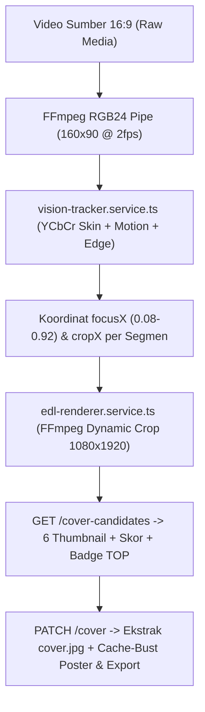

# Smart Face-Tracking Auto-Crop 9:16 & Cover Frame Selector

> **Informasi Modul**: Route: `/clips/:clipId` (Panel Cover Selector + Tab 4 Timeline Visual) & `/campaigns/:id/studio` (Mode Framing `auto_face_track`) | Penanggung Jawab: **AhmadArifff** | Status: **`Done`** | Terakhir Diperbarui: **2026-11-28**

---

## 1. Ringkasan Eksekutif (3 Kalimat Inti)

1. **Fungsi Produk**: Memungkinkan pemotongan video horizontal (`16:9`) ke format vertikal (`9:16`) mengikuti posisi wajah atau pembicara aktif secara otomatis (*Smart Auto-Track 9:16*) sekaligus menyediakan pemindai 6 kandidat frame sampul (*cover*) terbaik agar kreator tidak lagi mendapat potongan wajah terpotong atau thumbnail buram.
2. **Alur & Mesin Utama**: Mesin vision lokal murni Node.js + FFmpeg (`vision-tracker.service.ts`) mengekstrak sampel RGB24 ringan (`160x90 @ 2fps`) lewat pipe memori tanpa Python maupun file sementara, menghitung klaster wajah (*YCbCr skin cluster* + bobot zona kepala + delta gerakan) untuk menghasilkan koordinat `focusX` (`0.08`-`0.92`) per segmen, serta memeringkat 6 kandidat cover berdasarkan ketajaman, pencahayaan, dan fokus subjek.
3. **Dampak Nyata**: Video podcast 2-pembicara atau kamera lebar langsung terpusat rapi di `1080x1920`, dan sampul `cover.jpg` terbaik otomatis terbawa saat pengguna mengunduh satuan maupun arsip Bulk ZIP.

---

## 2. Core Flow & Topologi Arsitektur

### Alur Kerja Normal (Happy Path)
1. **Otomatis Saat Generate Batch (`M6 + M13`)**: User memilih preset **`Smart Auto-Track 9:16 (Ikuti Wajah/Subjek Aktif)`** pada kolom *Mode Framing 16:9 -> 9:16* di Studio Campaign. Saat worker memproses batch, `edl-director.service.ts` membagi shot panjang menjadi 2-4 jendela tracking, lalu `render-queue.worker.ts` memanggil `analyzeSubjectFocusTrack()` untuk mengisi `focusX` & `cropX` sebelum FFmpeg merender crop dinamis `clip(iw*focusX - w/2, 0, iw - w)`.
2. **Interaktif di Visual Timeline (`M12 + M13`)**: Di Tab **`Timeline Visual`**, user dapat mengklik **`Auto-Deteksi Fokus Subjek`** (`POST /api/clips/:clipId/auto-track-crop`) untuk memindai seluruh segmen draft, menggeser slider **Posisi Horizontal Fokus X (`8%`-`92%`)** secara presisi per segmen, lalu menekan **`Render Timeline ke v(N+1)`**.
3. **Pemilihan Cover Terbaik (`Cover Frame Selector`)**: Di kolom kiri Clip Inspector (`/clips/:clipId`), user mengklik **`Pindai 6 Kandidat Cover`** (`GET /api/clips/:clipId/cover-candidates`) untuk melihat 6 thumbnail lengkap dengan skor dan lencana **`TOP`**, atau menggeser video lalu mengklik **`Pakai Frame Playhead`** (`PATCH /api/clips/:clipId/cover`) agar berkas `cover.jpg` langsung diperbarui dan tersinkron ke `<video poster>`, tombol unduh `Cover (.jpg)`, dan Bulk ZIP.

### Diagram Alir Proses (Mermaid)

### Peta Komponen Arsitektur
- **Shared Schema**: `packages/shared/src/index.ts` (`FramingModeSchema` menyertakan `'auto_face_track'`, `EdlSegmentSchema.focusX`)
- **Backend Vision & Renderer**: `apps/api/src/services/media/vision-tracker.service.ts`, `apps/api/src/services/media/edl-renderer.service.ts`
- **Backend Director, Worker & Endpoints**: `apps/api/src/services/ai/edl-director.service.ts`, `apps/api/src/workers/render-queue.worker.ts`, `apps/api/src/services/clip.service.ts`, `apps/api/src/controllers/clip.controller.ts`, `apps/api/src/routes/clip.routes.ts`
- **Frontend UI**: `apps/web/components/studio/VisualTimelineEditor.vue`, `apps/web/pages/clips/[clipId].vue`

---

## 3. Matriks Keterlibatan Basis Data & Storage Lokal

| Tabel Prisma / Storage | Kolom / File Kunci | Tipe Aksi | Skenario Alur | Keterangan & Logika Status |
| :--- | :--- | :--- | :--- | :--- |
| `master_presets` | `category = 'framing_mode'`, `code = 'auto_face_track'` | `UPSERT` / `SELECT` | **Seed & Target Generator** | Menjadi preset dinamis ke-38 di dropdown Mode Framing 9:16 |
| `clip_versions` | `edl_json`, `cover_image_path` | `INSERT` / `UPDATE` | **Auto-Track Render & Pilih Cover** | Menyimpan `focusX` di EDL JSON dan memastikan `cover_image_path` valid |
| `storage/renders/<batch>/<clip>/v<N>/` | `cover-cand-0.jpg` .. `cover-cand-5.jpg` | `WRITE` / `READ` | **Pindai 6 Kandidat Cover** | Thumbnail pratinjau ringan (lebar `320px`) per versi klip |
| `storage/renders/<batch>/<clip>/v<N>/` | `cover.jpg` | `WRITE` / `READ` | **Terapkan Cover Baru** | Ditimpa ulang dari timestamp pilihan dan langsung dipakai download satuan & ZIP |

---

## 4. Logika Bisnis, Keamanan & Validasi Kunci

1. **Zero Shell Injection & Path Traversal Guard**: Seluruh proses ekstraksi RGB pipe, thumbnail kandidat, dan `cover.jpg` dijalankan lewat `child_process.spawn(env.FFMPEG_PATH, argsArray, { shell: false })` serta diproteksi `resolveSafeStoragePath()`. Indeks kandidat divalidasi ketat `0 <= idx <= 5` (selain itu ditolak `400`).
2. **Rumus Geometri Crop Terpusat Akurat**: Untuk menjaga subjek di sisi kiri atau kanan tidak keluar bingkai 9:16, filter FFmpeg menggunakan ekspresi `crop=W:H:x='trunc(clip(iw*focusX-W/2,0,iw-W))':y='trunc((ih-H)/2)'` sehingga pusat subjek tetap berada tepat di tengah bingkai vertikal.
3. **Anti-Stale Browser Cache**: Endpoint `GET /api/clips/:clipId/cover` dan `GET /api/clips/:clipId/cover-candidate/:idx` mengirim header `Cache-Control: no-store`, dan frontend menambahkan query `?cb=<timestamp>` pada `:poster` pemutar video saat cover diganti.
4. **Zero Cloud & Zero Extra Runtime**: Seluruh analisis vision berjalan 100% lokal di CPU memakai FFmpeg yang sudah terpasang tanpa perlu mengunduh model Python/ONNX puluhan megabita.

---

## 5. Skenario Edge Cases & Celah Lapangan (*Field Edge-Case & Gap Audit*)

| No | Skenario Edge Case | Potensi Risiko Lapangan | Solusi & Penanganan Sistem |
| :---: | :--- | :--- | :--- |
| 1 | **Video tanpa wajah manusia (screen recording / produk / pemandangan)** | Deteksi warna kulit tidak menemukan piksel wajah (`skinRatio < 1.5%`). | Sistem otomatis fallback ke bobot **gerakan antar-frame + ketajaman tepi (`motion_edge`)** atau posisi seimbang `0.50` (`balanced_center`), dan user tetap bisa menggeser slider Fokus X manual. |
| 2 | **Video 2-pembicara berpindah di detik batas persis (mis. detik `3.0s`)** | Sampel frame dari segmen tetangga tercampur saat dirata-ratakan. | `analyzeSubjectFocusTrack` memprioritaskan filter jendela ketat `startSec <= t < endSec` sebelum fallback ke toleransi `+-0.25s`. |
| 3 | **Ganti versi (`v1` -> `v2`) setelah memindai kandidat cover** | Grid thumbnail menampilkan kandidat dari versi sebelumnya. | `watch(selectedVersion)` otomatis mereset `coverCandidates` dan `activeCoverTs` setiap kali user berpindah versi. |

---

## 6. Checklist Pengujian & Hasil yang Diharapkan (Smoke Test)

| ID Uji | Skenario Uji | Input Data | Hasil UI yang Diharapkan | Hasil DB / Media yang Diharapkan |
| :--- | :--- | :--- | :--- | :--- |
| `TC-01` | Auto-Track pada video 2-pembicara Kiri (`0-3s`) & Kanan (`3-6s`) | `POST /api/clips/:id/auto-track-crop` | Toast fokus wajah terdeteksi, dropdown pindah ke `Smart Auto-Track 9:16`, blok segmen menampilkan `left` lalu `right` | Segmen 0 `focusX < 0.38` (`left`), Segmen 1 `focusX > 0.62` (`right`), render `v2` lulus `ffprobe 1080x1920` |
| `TC-02` | Pindai 6 Kandidat Cover & Terapkan Cover Baru | `GET /cover-candidates` + `PATCH /cover` | Muncul 6 kartu thumbnail + tepat 1 badge **`TOP`**, klik kartu menampilkan toast `Sampul cover diperbarui` | 6 berkas `cover-cand-0..5.jpg` dan `cover.jpg` baru berukuran `> 1 KB` dengan header `image/jpeg` |
| `TC-03` | Uji Akses Indeks Kandidat Ilegal | `GET /cover-candidate/9` | Ditolak aman | HTTP `400 INVALID_CANDIDATE_INDEX` |

---

## 7. Panduan Tanya-Jawab Cepat (*Operational Q&A*)

- **Pertanyaan:** *Apakah cover yang dipilih di Cover Frame Selector ikut masuk ke arsip Bulk ZIP?*
  - **Jawaban:** Ya. Mengklik kandidat cover atau tombol **Pakai Frame Playhead** langsung menimpa berkas `cover.jpg` milik versi tersebut di penyimpanan lokal, sehingga tombol unduh satuan `Cover (.jpg)` maupun ekspor Bulk ZIP otomatis menyertakan cover terbaru.

---

## 8. Riwayat Perubahan (*Changelog*)

| Tanggal | Commit Hash | Pengembang | Milestone | Ringkasan Perubahan & Dampak |
| :--- | :--- | :--- | :--- | :--- |
| 2026-11-28 | `HEAD` | AhmadArifff | **M13 (V2)** | Implementasi `vision-tracker.service.ts` (YCbCr Skin + Motion/Edge Auto-Track & 6-Candidate Cover Ranker), integrasi worker & dynamic crop FFmpeg, endpoint `/auto-track-crop`, `/cover-candidates`, `/cover-candidate/:idx`, `PATCH /cover`, kontrol Fokus X di `VisualTimelineEditor.vue`, dan panel Cover Frame Selector di `/clips/:clipId`. |
| 2026-11-28 | `HEAD` | AhmadArifff | **M21 (V2)** | Tambah tombol unduh langsung `HD` (Full HD asli) dan `YT 16:9` (Thumbnail YouTube `1280x720` fit-blur-bg) pada masing-masing 6 kartu kandidat cover melalui `extractCoverVariantAtTimestamp()` & `?download=1&format=hd\|yt16x9`, serta tombol cepat *Unduh Aktif* di header panel Cover Selector. |

---

## 9. Peta Alur & Flow Testing Per-Konten UI

### 9A. Matriks Keterlacakan Per-Konten

| No | Elemen UI & File Vue | Composable / Client | Endpoint HTTP | Rantai Fungsi Backend | Tabel DB / Storage Terdampak |
| :---: | :--- | :--- | :--- | :--- | :--- |
| **1** | **Tombol Auto-Deteksi Fokus Subjek & Slider Fokus X** `apps/web/components/studio/VisualTimelineEditor.vue` | `apiRequest('/api/clips/:clipId/auto-track-crop')` | `POST /api/clips/:clipId/auto-track-crop` | `clipController.autoTrackCrop` -> `clipService.autoTrackCrop` -> `analyzeSubjectFocusTrack` | Membaca `storage/uploads/...` via FFmpeg RGB pipe |
| **2** | **Tombol Pindai 6 Kandidat Cover** `apps/web/pages/clips/[clipId].vue` | `apiRequest('/api/clips/:clipId/cover-candidates')` | `GET /api/clips/:clipId/cover-candidates` & `GET /cover-candidate/:idx` | `clipController.coverCandidates` -> `clipService.getCoverCandidates` -> `extractAndRankCoverCandidates` | Menulis `cover-cand-0..5.jpg` di folder versi |
| **3** | **Kartu Kandidat & Tombol Pakai Frame Playhead** `apps/web/pages/clips/[clipId].vue` | `apiRequest('/api/clips/:clipId/cover')` | `PATCH /api/clips/:clipId/cover` | `clipController.setCover` -> `clipService.setCoverFrame` -> `extractCoverAtTimestamp` | Menimpa `cover.jpg` & memperbarui `clip_versions.cover_image_path` |

### 9B. Flow Testing Per-Konten dengan Ilustrasi Data Kasar

#### Konten 1: Pindai & Terapkan Cover Terbaik (`Cover Frame Selector`)
- **Kondisi Awal di Layar:** Klip `v1` terbuka di `/clips/:clipId` dengan panel **Pemilih Sampul / Cover Terbaik** di kolom kiri.
- **Langkah Uji:** Klik **`Pindai 6 Kandidat Cover`** -> tunggu 6 thumbnail muncul dengan 1 badge **`TOP`** -> klik kandidat ke-2.
- **Hasil UI yang Diharapkan:** Banner hijau `Sampul cover v1 diperbarui dari detik ...s!` muncul, badge `Aktif: ...s` menyala, dan `:poster` `<video>` langsung segar.
- **Hasil DB / Media yang Diharapkan:** File `storage/renders/<batch>/<clip>/v1/cover.jpg` diperbarui dengan frame baru.

#### Konten 2: Belah Segmen + Auto-Deteksi Fokus Subjek -> Render `v2`
- **Kondisi Awal di Layar:** Tab **`Timeline Visual`** menampilkan 1 segmen video sumber 2-pembicara (kiri `0-3s`, kanan `3-6s`).
- **Langkah Uji:** Klik **`Belah Segmen`** (menjadi `2 Segmen`) -> klik **`Auto-Deteksi Fokus Subjek`** -> klik **`Render Timeline ke v2`**.
- **Hasil UI yang Diharapkan:** Dropdown `#tl-framing` otomatis berpindah ke `auto_face_track`, blok segmen menampilkan koordinat kiri & kanan, dan `v2` selesai dirender dengan label `Framing: auto_face_track`.
- **Hasil DB / Media yang Diharapkan:** `v2/video.mp4` berukuran `1080x1920` dengan crop horizontal dinamis sesuai `focusX` tiap segmen.

---

## 10. Disambiguasi Fitur Kembar & Batas Konteks Lintas-Menu

| Topik / Fitur Mirip | Yang Ditangani di Modul INI (M13 Smart Auto-Track & Cover) | Yang Berada di Modul LAIN | Perbedaan Kunci |
| :--- | :--- | :--- | :--- |
| **Framing `center_crop` vs `auto_face_track`** | Menghitung koordinat `focusX` (`0.08`-`0.92`) per segmen berdasarkan deteksi wajah/gerakan lalu memusatkan crop 9:16 pada subjek. | `center_crop` (`M6`) selalu memotong tetap di tengah (`50%`) tanpa analisis isi frame. | `auto_face_track` menjaga wajah pembicara di kiri/kanan tidak terpotong. |
| **Cover Default vs Cover Frame Selector** | Memindai 6 kandidat berperingkat skor atau mengekstrak frame persis dari posisi playhead `<video>` kapan saja pasca-render. | Render awal (`M6`) otomatis mengambil 1 frame default di detik `1.2s`. | User bisa mengganti cover tanpa harus merender ulang seluruh MP4. |

- **Batas Tanggung Jawab Modul Ini:**
  - **BERTANGGUNG JAWAB ATAS:** Deteksi fokus horizontal subjek/wajah 9:16 lokal, pemeringkatan 6 kandidat cover, dan pembaruan berkas `cover.jpg` per versi klip.
  - **TIDAK MENANGANI:** Transkrip ucapan STT (`M5`), kloning BPM/scene-cut video referensi (`M11`), maupun ekspor arsip ZIP massal (`M9`).
