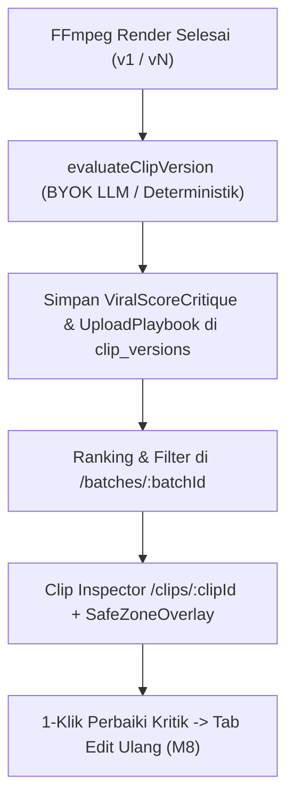

# Viral Score Engine, Projected Impact, Critique & Upload Playbook

> **Informasi Modul**: Route: `/campaigns/:id/batches/:batchId` (Ranking & Filter) & `/clips/:clipId` (Tab Skor & Kritik + Tab Upload Playbook) | Penanggung Jawab: **AhmadArifff** | Status: **`Done`** | Terakhir Diperbarui: **2026-11-26**

---

## 1. Ringkasan Eksekutif (3 Kalimat Inti)

1. **Fungsi Produk**: Mengevaluasi setiap versi hasil render video menggunakan rubrik transparan 6 dimensi (0-100), memeriksa kepatuhan terhadap aturan brief campaign (`PASS`/`WARN`/`FAIL`), memproyeksikan dampak saat di-upload ke audiens target, memberi kritik per timestamp, serta menyusun Upload Playbook siap tempel.
2. **Alur & Mesin Utama**: Setelah setiap klip selesai dirender FFmpeg, `viral-evaluator.service.ts` menjalankan evaluasi terstruktur Zod via BYOK LLM (dengan fallback deterministik lokal) lalu menautkannya secara sinkron terhadap kondisi fisik audio dan safe-zone pada EDL.
3. **Dampak Nyata**: Kreator tidak perlu menebak variasi mana yang paling kuat atau bingung mengatur musik, caption, hashtag, dan jam tayang lintas zona waktu, serta dapat memverifikasi area tombol TikTok/YouTube Shorts secara visual melalui Safe-Zone Overlay sebelum mengunduh.

---

## 2. Core Flow & Topologi Arsitektur

### Alur Kerja Normal (Happy Path)
1. Begitu `render-queue.worker.ts` merampungkan render `v1` sebuah klip (atau `clip.service.ts` merampungkan `v(N+1)`), backend otomatis memanggil `evaluateClipVersion()` untuk menghasilkan `ViralScoreCritique` dan `UploadPlaybook`.
2. Di halaman hasil batch (`/campaigns/:id/batches/:batchId`), seluruh variasi diurutkan dari skor viral tertinggi lengkap dengan badge skor, status kepatuhan brief, status Final, serta filter cepat (`Semua`, `Skor >= 80`, `Brief PASS`, `Ditandai Final`).
3. User klik tombol **Inspeksi, Playbook & Edit** menuju `/clips/:clipId`, mengaktifkan **Overlay Safe-Zone** (`Off` | `TikTok` | `YT Shorts`), memeriksa 6 dimensi skor + proyeksi dampak + kritik bertimestamp (klik `Lompat ke 00:xx` untuk langsung seek video atau klik `Perbaiki dengan Prompt` untuk melompat ke Tab Edit Ulang), lalu menyalin seluruh **Upload Playbook** dalam 1 klik.

### Diagram Alir Proses (Mermaid)

### Peta Komponen Arsitektur
- **Frontend Pages & Components**: `apps/web/pages/clips/[clipId].vue`, `apps/web/components/studio/SafeZoneOverlay.vue`, `apps/web/pages/campaigns/[id]/batches/[batchId].vue`
- **Backend Routes & Controller**: `apps/api/src/routes/clip.routes.ts`, `apps/api/src/controllers/clip.controller.ts`
- **Backend Services**: `apps/api/src/services/ai/viral-evaluator.service.ts`, `apps/api/src/services/clip.service.ts`, `apps/api/src/workers/render-queue.worker.ts`
- **Shared Zod Contracts**: `ViralScoreCritiqueSchema` & `UploadPlaybookSchema` di `packages/shared/src/index.ts`

---

## 3. Matriks Keterlibatan Basis Data & Storage Lokal

| Tabel Prisma / Storage | Kolom / File Kunci | Tipe Aksi | Skenario Alur | Keterangan & Logika Status |
| :--- | :--- | :--- | :--- | :--- |
| `clip_versions` | `viral_score_total`, `brief_compliance`, `score_breakdown_json`, `impact_critique_json`, `upload_playbook_json` | `INSERT` / `UPDATE` | **Core Flow** | Tersimpan per versi (`v1..vN`) untuk mendukung perbandingan delta skor |
| `clips` | `active_version_id`, `is_approved` | `SELECT` / `UPDATE` | **Core Flow** | Menandai versi aktif & status siap upload (`FINAL`) |
| `campaign_briefs` | `parsed_rulebook_json` | `SELECT` | **Core Flow** | Referensi aturan durasi, hashtag wajib, mention wajib, dan CTA |

---

## 4. Logika Bisnis, Keamanan & Validasi Kunci

1. **Sinkronisasi Audio Fisik ke Upload Playbook**: Instruksi mixing musik di `uploadPlaybook.audioMusicGuide.renderedAudioState` dan `platformMixingInstruction` wajib diturunkan langsung dari `edl.audio.muteOriginal` dan `edl.audio.originalVolume` aktual sehingga tidak pernah bertentangan dengan berkas MP4 yang diunduh.
2. **Validasi Skema Zod Ketat**: Keluaran AI LLM divalidasi penuh oleh `ViralScoreCritiqueSchema` dan `UploadPlaybookSchema` sebelum disimpan; jika respons LLM gagal atau kuota habis, fallback deterministik menjaga skor dan playbook tetap terisi valid.
3. **Jadwal Tayang Berbasis Country & Timezone**: Peta jadwal mencakup `ID` (`Asia/Jakarta WIB`), `US` (`EST`), `UK` (`GMT`), `MY` (`MYT`), `SG` (`SGT`), dan fallback lintas zona waktu.
4. **Isolasi Kepemilikan Data (IDOR Guard)**: `GET /api/clips/:clipId` selalu memverifikasi `batch.campaign.userId === req.user.sub`.

---

## 5. Skenario Edge Cases & Celah Lapangan (*Field Edge-Case & Gap Audit*)

| No | Skenario Edge Case | Potensi Risiko Lapangan | Solusi & Penanganan Sistem |
| :---: | :--- | :--- | :--- |
| 1 | **Video hasil render bervolume 100% pada target TikTok** | Suara asli tabrakan dengan sound musik trending TikTok saat upload. | Evaluator otomatis memunculkan kritik spesifik beserta tombol 1-klik *"Perbaiki dengan Prompt"* untuk mengecilkan ke 15% atau mute total 0%. |
| 2 | **Subtitle terlalu rendah mendekati area caption TikTok/Shorts** | Teks tertutup nama akun dan ticker musik di layar HP. | Safe-Zone Overlay menampakkan batas zona merah secara visual, dan dimensi `audioSafeZone` menandai peringatan otomatis. |
| 3 | **Browser tidak mengizinkan `navigator.clipboard` pada akses LAN HTTP** | Tombol *Salin Semua Playbook* gagal menyalin di HP lewat IP LAN. | Fungsi `copyText` menyediakan fallback `textarea` + `execCommand('copy')` agar tetap bekerja di konteks HTTP LAN lokal. |
| 4 | **Target negara US/UK/Global namun hashtag/caption Playbook mengandung `#tiktokindonesia`** | Distribusi algoritma TikTok/YouTube melenceng ke audiens Indonesia. | `viral-evaluator.service.ts` mengunci 100% `titleOptions`, `captionDescription`, `hashtags`, dan `pinnedComments` ke Bahasa Inggris serta menyaring blocklist tag Indonesia untuk negara non-`ID`. |
| 5 | **Tata letak Safe-Zone Overlay meleset dari tampilan nyata aplikasi HP** | Kreator salah mengira area aman atas/kanan/bawah. | `SafeZoneOverlay.vue` & `ass-subtitle.builder.ts` dikalibrasi ulang mengikuti proporsi nyata HP 2026 untuk TikTok (`top 10%`, `right 20%`, `bottom 30%`) & YouTube Shorts (`top-right Search/...`, `right 20%`, `bottom 23%` dengan tombol Subscribe putih). |

---

## 6. Checklist Pengujian & Hasil yang Diharapkan (Smoke Test)

| ID Uji | Skenario Uji | Input Data | Hasil UI yang Diharapkan | Hasil DB / API yang Diharapkan |
| :--- | :--- | :--- | :--- | :--- |
| `TC-01` | Evaluasi otomatis pasca-render `v1` (Original 100%, Target ID TikTok) | Batch 1 klip selesai render | Skor 0-100, 6 progress bar dimensi, Audit Brief, 4 kartu Dampak, Kritik audio TikTok, Playbook jadwal WIB & audio 100% | `clip_versions.viral_score_total >= 50`, `upload_playbook_json` memuat `Asia/Jakarta (WIB)` & `100%` |
| `TC-02` | Toggle Safe-Zone Overlay TikTok & YT Shorts + Seek Timestamp Kritik | Klik tombol `TikTok` & `Lompat ke 00:01` | Overlay zona atas, rail kanan, dan zona bawah tampil tanpa menutupi kontrol klik; video melompat ke detik kritik | Tidak ada mutasi DB; state UI reaktif |

---

## 7. Panduan Tanya-Jawab Cepat (*Operational Q&A*)

- **Pertanyaan:** *Apakah skor viral berubah saat saya mengedit ulang video ke `v2`?*
  - **Jawaban:** Ya. Setiap kali versi baru (`v2`, `v3`, dst.) selesai dirender, sistem otomatis menjalankan evaluasi ulang dan menampilkan selisih skor (contoh: `+1 vs v1` atau `+7 vs v1`) di samping skor versi aktif.

---

## 8. Riwayat Perubahan (*Changelog*)

| Tanggal | Commit Hash | Pengembang | Milestone | Ringkasan Perubahan & Dampak |
| :--- | :--- | :--- | :--- | :--- |
| 2026-11-26 | `HEAD` | AhmadArifff | **M7** | Implementasi Viral Score Engine 6 dimensi, Brief Compliance Checklist, Projected Impact, Actionable Critique per timestamp, Upload Playbook tersinkron audio, ranking batch, dan Safe-Zone Overlay Player. |
| 2026-11-28 | `HEAD` | AhmadArifff | **M17** | Kunci Bahasa Target Negara pada Upload Playbook (anti-leak `#tiktokindonesia` untuk pasar US/Global) serta kalibrasi pixel-accurate `SafeZoneOverlay.vue` & margin ASS mengikuti antarmuka HP nyata 2026 TikTok & YouTube Shorts. |

---

## 9. Peta Alur & Flow Testing Per-Konten UI

### 9A. Matriks Keterlacakan Per-Konten

| No | Elemen UI & File Vue | Composable / Client | Endpoint HTTP | Rantai Fungsi Backend | Tabel DB / Storage Terdampak |
| :---: | :--- | :--- | :--- | :--- | :--- |
| **1** | **Filter & Urutan Ranking Batch** `apps/web/pages/campaigns/[id]/batches/[batchId].vue` | `apiRequest('/api/batches/:batchId')` | `GET /api/batches/:batchId` | `batchController.detail` -> `batchService.getBatchDetail` | `generation_batches`, `clips`, `clip_versions` (`SELECT`) |
| **2** | **Inspektor Skor, Kritik & Playbook** `apps/web/pages/clips/[clipId].vue` | `apiRequest('/api/clips/:clipId')` | `GET /api/clips/:clipId` | `clipController.detail` -> `clipService.getClipDetail` | `clips`, `clip_versions`, `media_assets` (`SELECT`) |
| **3** | **Toggle Safe-Zone Overlay** `apps/web/components/studio/SafeZoneOverlay.vue` | State reaktif lokal `safeZoneMode` | - | Pure UI overlay di atas `<video>` | Tidak ada |

### 9B. Flow Testing Per-Konten dengan Ilustrasi Data Kasar

#### Konten 1: Inspeksi Skor Viral, Safe-Zone TikTok & Upload Playbook `v1`
- **Kondisi Awal di Layar:** Batch memiliki 1 klip selesai (`Status: COMPLETED`) dengan audio awal `Original 100%`.
- **Langkah Uji:** Klik tombol **`Inspeksi, Playbook & Edit`** -> periksa Tab **`Skor & Kritik`** -> klik **`TikTok`** pada bar `Overlay Safe-Zone` -> pindah ke Tab **`Upload Playbook`** -> klik **`Salin Semua Playbook`**.
- **Hasil UI yang Diharapkan:** Skor 6 dimensi, Audit Kepatuhan Brief, Proyeksi Dampak, Kritik bertimestamp, overlay Safe-Zone TikTok tampil presisi; Tab Upload Playbook menampilkan status `Audio Vokal Asli Penuh (100%, -14 LUFS)`, 3 opsi judul, caption dengan `#BrandM78`, dan jadwal `Asia/Jakarta (WIB)`.
- **Hasil DB / Media yang Diharapkan:** Data JSON evaluasi tersimpan utuh pada baris `clip_versions` untuk `v1`.

---

## 10. Disambiguasi Fitur Kembar & Batas Konteks Lintas-Menu

| Topik / Fitur Mirip | Yang Ditangani di Modul INI (`/clips/:clipId` Tab Skor & Playbook) | Yang Berada di Modul LAIN | Perbedaan Kunci |
| :--- | :--- | :--- | :--- |
| **Brief Compliance / Aturan Brief** | Mengaudit hasil render video terhadap rulebook brief (`PASS`/`WARN`/`FAIL`). | Mengedit & mengonfirmasi rulebook brief sumber di `/campaigns/:id/studio` (`M5`). | M5 menetapkan aturan; M7 menilai kepatuhan hasil video terhadap aturan tersebut. |

- **Batas Tanggung Jawab Modul Ini:**
  - **BERTANGGUNG JAWAB ATAS:** Penilaian 6 dimensi skor viral, proyeksi dampak upload, daftar kritik actionable, Upload Playbook tersinkron, ranking variasi, dan Safe-Zone Overlay.
  - **TIDAK MENANGANI:** Mutasi patch EDL & render versi baru (`M8`) maupun pengemasan bulk ZIP download (`M9`).
