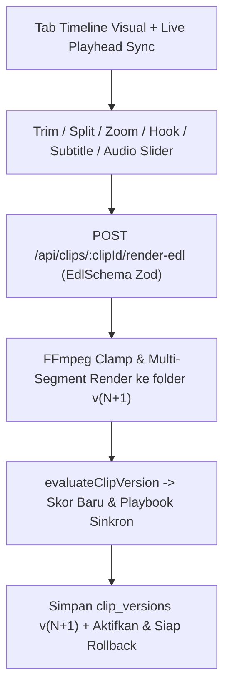

# Visual Multi-Track Timeline Editor Interaktif (Direct EDL v1.1)

> **Informasi Modul**: Route: `/clips/:clipId` (Tab 4: `Timeline Visual`) | Penanggung Jawab: **AhmadArifff** | Status: **`Done`** | Terakhir Diperbarui: **2026-11-28**

---

## 1. Ringkasan Eksekutif (3 Kalimat Inti)

1. **Fungsi Produk**: Memberikan editor visual 4-track (*Overlay Hook/CTA*, *Potongan Video*, *Subtitle Safe-Zone*, dan *Audio Mixing*) langsung di browser agar kreator dapat memangkas, membelah (*split*), menyusun ulang urutan potongan, mengatur zoom/crop, dan memindahkan posisi safe-zone secara presisi tanpa bergantung pada prompt teks saja.
2. **Alur & Mesin Utama**: Komponen `VisualTimelineEditor.vue` menyinkronkan jarum playhead secara live terhadap pemutar `<video>`, memodifikasi draft `EdlDocument v1.1`, lalu mengirimkannya ke `POST /api/clips/:clipId/render-edl` untuk dirender lokal oleh FFmpeg `8.1.2` ke versi non-destruktif `v(N+1)`.
3. **Dampak Nyata**: Kreator mendapatkan kecepatan otomatisasi AI sekaligus kendali presisi ala mini-NLE tanpa biaya cloud, lengkap dengan hitung ulang Viral Score otomatis, sinkronisasi Upload Playbook, dan Rollback ke versi sebelumnya kapan saja.

---

## 2. Core Flow & Topologi Arsitektur

### Alur Kerja Normal (Happy Path)
1. User membuka halaman Inspektor Klip (`/clips/:clipId`) lalu berpindah ke Tab ke-4 **Timeline Visual**.
2. User dapat mengklik **Time Ruler** untuk melompatkan posisi pemutaran `<video>`, memilih blok segmen video untuk mengatur **Titik Mulai/Selesai (In/Out)**, **Zoom (`1.0x`-`2.0x`)**, **Fokus Crop**, **Framing 9:16**, atau menekan **Belah Segmen** / **Tambah Segmen** / **Duplikat** / **Geser Kiri-Kanan**.
3. User juga dapat mengedit teks & waktu **Hook Banner**, **CTA Penutup**, posisi vertikal **Subtitle Safe-Zone (`45%`-`82%`)**, serta slider **Volume Audio Asli (`0%`-`120%`)** beserta tombol cepat `Mute 0%` | `Duck 15%` | `Duck 25%` | `100%`.
4. User menekan **Render Timeline ke v(N+1)** (`POST /api/clips/:clipId/render-edl`) -> backend memvalidasi `EdlSchema`, merender MP4 baru di folder `v(N+1)/`, menghitung ulang skor & Playbook, lalu memperbarui player dan Riwayat Versi.

### Diagram Alir Proses (Mermaid)

### Peta Komponen Arsitektur
- **Frontend**: `apps/web/components/studio/VisualTimelineEditor.vue`, `apps/web/pages/clips/[clipId].vue`
- **Backend Routes & Controller**: `apps/api/src/routes/clip.routes.ts`, `apps/api/src/controllers/clip.controller.ts`
- **Backend Services**: `apps/api/src/services/clip.service.ts` (`renderCustomEdl`), `apps/api/src/services/media/edl-renderer.service.ts`, `apps/api/src/services/ai/viral-evaluator.service.ts`

---

## 3. Matriks Keterlibatan Basis Data & Storage Lokal

| Tabel Prisma / Storage | Kolom / File Kunci | Tipe Aksi | Skenario Alur | Keterangan & Logika Status |
| :--- | :--- | :--- | :--- | :--- |
| `media_assets` | `duration_sec`, `width`, `height`, `has_audio` | `SELECT` | **Batas Trim Timeline** | Dikirim sebagai `sourceMediaList` di `GET /api/clips/:clipId` |
| `clip_versions` | `version_number`, `edl_json`, `output_video_path`, `viral_score_total`, `upload_playbook_json` | `INSERT` | **Direct EDL Render** | Versi baru non-destruktif `v(N+1)` tanpa menimpa versi lama |
| `clips` | `active_version_id`, `status` | `UPDATE` | **Direct EDL Render** | Mengarahkan versi aktif ke hasil render timeline terbaru |
| `storage/renders/<batchId>/<clipId>/v(N+1)/` | `video.mp4`, `subtitles.ass`, `subtitles.srt`, `cover.jpg` | `WRITE` | **Direct EDL Render** | Output fisik terisolasi per nomor versi |

---

## 4. Logika Bisnis, Keamanan & Validasi Kunci

1. **Validasi Skema EDL Ketat (Zero Unvalidated Input)**: Endpoint `POST /api/clips/:clipId/render-edl` memvalidasi penuh payload `edl` dengan `EdlSchema` (Zod) sebelum memanggil FFmpeg; array `segments` kosong atau durasi ilegal ditolak `422`.
2. **Proteksi Durasi Minimal & Clamping**: UI menjaga `endSec >= startSec + 0.5s` dan melarang penghapusan segmen terakhir, sementara backend tetap menjalankan `clampEdlToMediaDurations()` terhadap panjang aktual footage sumber.
3. **Sinkronisasi Otomatis Mode Audio ke Upload Playbook**: Menggeser slider volume ke `0%` otomatis menetapkan `muteOriginal: true`, dan `< 90%` menetapkan `intendedPlatformSound`, sehingga panduan mixing musik pada Upload Playbook selalu sinkron 100%.
4. **Non-Destructive Versioning & Rollback**: Setiap render timeline mencetak folder versi baru sehingga user bebas membandingkan atau mengembalikan ke versi sebelumnya.

---

## 5. Skenario Edge Cases & Celah Lapangan (*Field Edge-Case & Gap Audit*)

| No | Skenario Edge Case | Potensi Risiko Lapangan | Solusi & Penanganan Sistem |
| :---: | :--- | :--- | :--- |
| 1 | **User menekan `Belah Segmen` pada segmen pendek (`< 1.0s`)** | Potongan terlalu pendek menyebabkan error trim FFmpeg. | UI menampilkan pesan ramah *"Durasi segmen minimal 1.0 detik untuk bisa dibelah"* dan menolak split secara aman. |
| 2 | **User mencoba menghapus seluruh segmen video** | EDL tidak memiliki segmen sama sekali. | Tombol `Hapus` dinonaktifkan saat `segments.length <= 1`, dan Zod backend menolak `segments: []` (`400`). |
| 3 | **Tampilan 4 tab pada layar HP `390px`** | Label tab meluap atau terpotong ellipsis. | Menggunakan label responsif singkat (`Skor`, `Playbook`, `Prompt`, `Timeline` pada `< sm`) dengan tinggi minimal `44px`. |

---

## 6. Checklist Pengujian & Hasil yang Diharapkan (Smoke Test)

| ID Uji | Skenario Uji | Input Data | Hasil UI yang Diharapkan | Hasil DB / Media yang Diharapkan |
| :--- | :--- | :--- | :--- | :--- |
| `TC-01` | Split 1 segmen -> 2 segmen + ubah Hook + Ducking 25% -> Render `v2` | `POST /api/clips/:id/render-edl` | Toast `Versi v2 selesai dirender dari Visual Timeline`, badge `Ducking 25%`, Playbook menampilkan `Ducking 25%` | `clip_versions` `v2` memiliki `edl.segments.length === 2`; `ffprobe` memverifikasi `1080x1920` valid |
| `TC-02` | Payload EDL kosong (`segments: []`) | `POST /api/clips/:id/render-edl` | Pesan error validasi | HTTP `422` tanpa memicu proses FFmpeg |

---

## 7. Panduan Tanya-Jawab Cepat (*Operational Q&A*)

- **Pertanyaan:** *Kapan sebaiknya memakai Tab `Edit Prompt` vs Tab `Timeline Visual`?*
  - **Jawaban:** Gunakan **Edit Prompt** untuk perbaikan cepat berbasis instruksi atau 1-klik dari daftar kritik, dan gunakan **Timeline Visual** ketika Anda ingin mengatur detik potong *in/out*, membelah segmen, zoom per potongan, atau menyetel persentase audio/safe-zone secara presisi manual.

---

## 8. Riwayat Perubahan (*Changelog*)

| Tanggal | Commit Hash | Pengembang | Milestone | Ringkasan Perubahan & Dampak |
| :--- | :--- | :--- | :--- | :--- |
| 2026-11-28 | `HEAD` | AhmadArifff | **M12 (V2)** | Implementasi Visual Multi-Track Timeline Editor 4-track (`VisualTimelineEditor.vue`), endpoint `POST /api/clips/:clipId/render-edl`, live playhead sync `<video>`, dan integrasi Tab 4 di Clip Inspector. |

---

## 9. Peta Alur & Flow Testing Per-Konten UI

### 9A. Matriks Keterlacakan Per-Konten

| No | Elemen UI & File Vue | Composable / Client | Endpoint HTTP | Rantai Fungsi Backend | Tabel DB / Storage Terdampak |
| :---: | :--- | :--- | :--- | :--- | :--- |
| **1** | **Time Ruler & Blok Track Video** `apps/web/components/studio/VisualTimelineEditor.vue` | Emit `@seek` -> `<video>.currentTime` | - | Interaksi client-side sinkron `@timeupdate` | Tidak ada |
| **2** | **Tombol Render Timeline ke v(N+1)** `apps/web/components/studio/VisualTimelineEditor.vue` | `apiRequest('/api/clips/:clipId/render-edl')` | `POST /api/clips/:clipId/render-edl` | `clipController.renderEdl` -> `clipService.renderCustomEdl` -> `renderEdlToMp4` -> `evaluateClipVersion` | `clip_versions` (`INSERT`), `clips` (`UPDATE`), `storage/renders/.../v(N+1)/` |

### 9B. Flow Testing Per-Konten dengan Ilustrasi Data Kasar

#### Konten 1: Belah Segmen + Ubah Hook + Ducking 25% -> Render `v2`
- **Kondisi Awal di Layar:** Halaman `/clips/:clipId` menampilkan `v1` dengan 1 segmen dan audio `Original 100%`.
- **Langkah Uji:** Klik Tab **`Timeline Visual`** -> klik **`Belah Segmen`** (tampil `2 Segmen`) -> ubah `#tl-hook-text` menjadi `"Hook Timeline Visual E2E!"` -> klik **`Duck 25%`** -> klik **`Render Timeline ke v2`** -> cek Tab **`Upload Playbook`**.
- **Hasil UI yang Diharapkan:** Versi `v2` aktif, strip audio menampilkan `Ducking 25%`, dan Tab Playbook menampilkan `Audio Asli Dikecilkan (Ducking 25%)`.
- **Hasil DB / Media yang Diharapkan:** `v2/video.mp4` (`1080x1920`) terverifikasi `ffprobe` dan `v1` tetap tersimpan utuh untuk rollback.

---

## 10. Disambiguasi Fitur Kembar & Batas Konteks Lintas-Menu

| Topik / Fitur Mirip | Yang Ditangani di Modul INI (Tab `Timeline Visual` - M12) | Yang Berada di Modul LAIN | Perbedaan Kunci |
| :--- | :--- | :--- | :--- |
| **Edit Ulang Klip (`v1 -> v2`)** | Modifikasi visual langsung 4-track atas `EdlDocument` (slider trim, split, zoom, hook, audio) via `/render-edl`. | Revisi berbasis bahasa alami + 9 chip preset cepat (`M8` Tab `Edit Prompt` via `/regenerate`). | Keduanya mencetak versi non-destruktif `v(N+1)` di Riwayat Versi yang sama. |

- **Batas Tanggung Jawab Modul Ini:**
  - **BERTANGGUNG JAWAB ATAS:** Pengeditan visual multi-track `EdlDocument` per klip, sinkronisasi playhead `<video>`, dan render langsung versi baru.
  - **TIDAK MENANGANI:** Generate awal multi-varian batch (`M6`) maupun ekstraksi ritme video referensi (`M11`).
