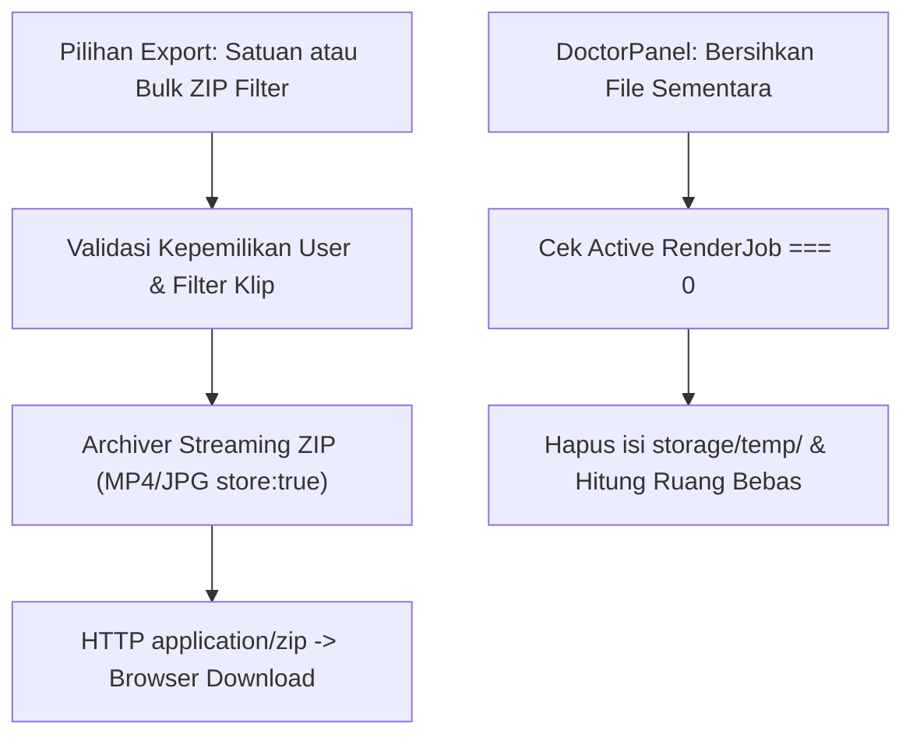

# Single Download & Bulk Streaming ZIP Bundle + Storage Hygiene

> **Informasi Modul**: Route: `/clips/:clipId` (Paket Unduh Satuan), `/campaigns/:id/batches/:batchId` (Panel Bulk Streaming ZIP), & `/settings/api-keys` (DoctorPanel Storage Hygiene) | Penanggung Jawab: **AhmadArifff** | Status: **`Done`** | Terakhir Diperbarui: **2026-11-27**

---

## 1. Ringkasan Eksekutif (3 Kalimat Inti)

1. **Fungsi Produk**: Memungkinkan kreator mengunduh aset per klip secara satuan (`.mp4`, `upload-playbook.txt`, `subtitles.srt`, `cover.jpg`) maupun mengunduh seluruh/sebagian variasi sekaligus dalam 1 arsip `.zip` terstruktur lengkap dengan ringkasan jadwal tayang.
2. **Alur & Mesin Utama**: Backend mengalirkan arsip ZIP secara langsung (*streaming*) menggunakan `archiver` dengan mode `store: true` untuk file `.mp4` & `.jpg` (anti-OOM dan hemat CPU) serta menyediakan pemantau kapasitas disk lokal dan tombol pembersihan aman berkas sementara (`storage/temp/`).
3. **Dampak Nyata**: Kreator dapat memindahkan seluruh paket konten siap upload dari laptop ke HP atau tim uploader dalam satu kali klik tanpa korup, tanpa menyalin manual satu per satu, dan tanpa khawatir kapasitas hard disk dipenuhi berkas sementara.

---

## 2. Core Flow & Topologi Arsitektur

### Alur Kerja Normal (Happy Path)
1. **Unduh Satuan**: Pada `/clips/:clipId`, user memilih berkas yang dibutuhkan pada panel **Paket Unduh Satuan** (`Video (.mp4)`, `Playbook (.txt)`, `Subtitle (.srt)`, atau `Cover (.jpg)`) yang memanggil `GET /api/clips/:clipId/download?type=...&versionId=...`.
2. **Bulk Streaming ZIP**: Pada `/campaigns/:id/batches/:batchId`, user memilih filter pada panel **Export & Unduh Keseluruhan (Bulk Streaming ZIP)** (`Unduh Semua Siap`, `ZIP Skor >= 80`, `ZIP Hanya Final`, atau mencentang klip tertentu lalu klik `ZIP Terpilih (N)`) yang memanggil `POST /api/batches/:batchId/export-zip`.
3. Backend mengurutkan klip dari skor viral tertinggi, membungkus `00-RINGKASAN-CAMPAIGN-DAN-JADWAL-UPLOAD.md` + folder `01-score-XX-[slug]-vN/` ke aliran HTTP `application/zip`, lalu browser langsung mengunduh arsip `.zip`.
4. **Storage Hygiene**: Pada `DoctorPanel` (`/settings/api-keys`), user memantau pemakaian ruang `Uploads`, `Renders`, dan `Temp` lalu menekan **Bersihkan File Sementara** (`POST /api/system/cleanup-temp`) ketika tidak ada job render aktif.

### Diagram Alir Proses (Mermaid)

### Peta Komponen Arsitektur
- **Frontend Pages & Components**: `apps/web/pages/campaigns/[id]/batches/[batchId].vue`, `apps/web/pages/clips/[clipId].vue`, `apps/web/components/studio/DoctorPanel.vue`
- **Backend Routes & Controller**: `apps/api/src/routes/export.routes.ts`, `apps/api/src/controllers/export.controller.ts`, `apps/api/src/routes/system.routes.ts`
- **Backend Services**: `apps/api/src/services/export.service.ts`, `apps/api/src/services/doctor.service.ts`

---

## 3. Matriks Keterlibatan Basis Data & Storage Lokal

| Tabel Prisma / Storage | Kolom / File Kunci | Tipe Aksi | Skenario Alur | Keterangan & Logika Status |
| :--- | :--- | :--- | :--- | :--- |
| `generation_batches`, `clips`, `clip_versions` | `status`, `is_approved`, `active_version_id`, `viral_score_total`, `output_video_path`, `output_srt_path`, `cover_image_path`, `upload_playbook_json` | `SELECT` | **Core Flow Export** | Memfilter klip siap export & merangkai `upload-playbook.txt` + ringkasan MD |
| `render_jobs` | `status` (`queued`, `processing`) | `SELECT` | **Storage Hygiene** | Mencegah pembersihan saat render sedang berjalan (`409 RENDER_IN_PROGRESS`) |
| `storage/renders/` | `video.mp4`, `subtitles.srt`, `cover.jpg` | `READ` | **Core Flow Export** | Di-stream langsung ke `archiver` tanpa menampung penuh di RAM |
| `storage/temp/` | Berkas sementara & potongan chunk terputus | `DELETE` | **Storage Hygiene** | Hanya menghapus isi di dalam `storage/temp/`, tidak menyentuh DB atau render aktif |

---

## 4. Logika Bisnis, Keamanan & Validasi Kunci

1. **Anti-OOM & Bebas Double Compression**: Video `.mp4` dan gambar `.jpg` dialirkan dengan `{ store: true }` pada `archiver` karena format H.264/JPEG sudah terkompresi sehingga menghemat CPU dan menjaga memori tetap rendah pada batch berukuran besar.
2. **Sanitasi Nama Berkas & Folder**: Seluruh judul campaign dan judul angle disanitasi melalui `slugifyFilename()` (ASCII huruf kecil, angka, tanda hubung) sehingga aman dibuka di Windows Explorer, macOS, Android, maupun iOS.
3. **Validasi Sebelum Header ZIP Dikirim**: Jika hasil filter (misal `ZIP Hanya Final`) menghasilkan 0 klip, endpoint mengembalikan JSON HTTP `400 NO_MATCHING_CLIPS_FOR_EXPORT` yang informatif alih-alih mengunduh file ZIP kosong/korup.
4. **Proteksi Cleanup Saat Render Aktif**: `POST /api/system/cleanup-temp` menolak eksekusi (`409`) apabila masih ada `render_jobs` berstatus `queued` atau `processing` agar tidak menghapus berkas kerja yang sedang dipakai FFmpeg.

---

## 5. Skenario Edge Cases & Celah Lapangan (*Field Edge-Case & Gap Audit*)

| No | Skenario Edge Case | Potensi Risiko Lapangan | Solusi & Penanganan Sistem |
| :---: | :--- | :--- | :--- |
| 1 | **User klik `ZIP Hanya Final` sebelum menandai klip mana pun sebagai Final** | Browser mengunduh file ZIP rusak atau error tak jelas. | Backend memvalidasi `matched.length === 0` lebih dulu dan mengembalikan pesan bahasa Indonesia yang tampil rapi di banner error UI. |
| 2 | **Judul variasi mengandung tanda kutip, emoji, atau karakter slash (`/`)** | Gagal ekstrak ZIP di Windows Explorer. | `slugifyFilename()` menormalisasi seluruh nama folder menjadi karakter alfanumerik dan tanda hubung saja. |
| 3 | **User membersihkan ruang disk sementara setelah banyak uji upload/chunk gagal** | Risiko salah hapus database SQLite atau video hasil render aktif. | `cleanupTemp` dibatasi secara ketat via `resolveSafeStoragePath('temp')` sehingga database dan folder `renders/` aktif 100% aman. |

---

## 6. Checklist Pengujian & Hasil yang Diharapkan (Smoke Test)

| ID Uji | Skenario Uji | Input Data | Hasil UI yang Diharapkan | Hasil DB / Media yang Diharapkan |
| :--- | :--- | :--- | :--- | :--- |
| `TC-01` | Unduh satuan `.mp4`, `.txt`, `.srt`, `.jpg` | `GET /api/clips/:id/download?type=...` | Browser mengunduh masing-masing berkas dengan nama rapi | Header `Content-Type` & `Content-Disposition` sesuai; `.txt` memuat `UPLOAD PLAYBOOK` tersinkron audio |
| `TC-02` | Bulk Streaming ZIP (`all` & `selected`) | `POST /api/batches/:id/export-zip` | Toast `Arsip ZIP berhasil diunduh: campaign-...zip` | Header magic `PK\x03\x04` valid; `tar -tf` menampilkan `00-RINGKASAN-CAMPAIGN-DAN-JADWAL-UPLOAD.md` + 2 folder lengkap |
| `TC-03` | Pembersihan folder sementara | `POST /api/system/cleanup-temp` | Pesan jumlah berkas dibersihkan & kapasitas `Temp` turun ke `0 MB` | File uji di `storage/temp/` terhapus, file MP4 aktif di `storage/renders/` tetap utuh |

---

## 7. Panduan Tanya-Jawab Cepat (*Operational Q&A*)

- **Pertanyaan:** *Apakah file `upload-playbook.txt` di dalam ZIP otomatis mengikuti hasil edit ulang versi terbaru (`v2`, `v3`)?*
  - **Jawaban:** Ya. Sistem selalu mengambil `activeVersionId` masing-masing klip saat menyusun arsip ZIP sehingga baik file `video-ready-upload.mp4` maupun `upload-playbook.txt` selalu berasal dari versi aktif terbaru (atau versi rollback yang sedang Anda aktifkan).

---

## 8. Riwayat Perubahan (*Changelog*)

| Tanggal | Commit Hash | Pengembang | Milestone | Ringkasan Perubahan & Dampak |
| :--- | :--- | :--- | :--- | :--- |
| 2026-11-27 | `HEAD` | AhmadArifff | **M9** | Implementasi Single File Export (`.mp4`, `.txt`, `.srt`, `.jpg`), Bulk Streaming ZIP (`archiver` `store: true` + filter & checklist), serta Storage Breakdown & Safe Temp Cleanup pada DoctorPanel. |

---

## 9. Peta Alur & Flow Testing Per-Konten UI

### 9A. Matriks Keterlacakan Per-Konten

| No | Elemen UI & File Vue | Composable / Client | Endpoint HTTP | Rantai Fungsi Backend | Tabel DB / Storage Terdampak |
| :---: | :--- | :--- | :--- | :--- | :--- |
| **1** | **Paket Unduh Satuan (4 Tombol)** `apps/web/pages/clips/[clipId].vue` | Link `<a :href>` langsung | `GET /api/clips/:clipId/download` | `exportController.downloadSingle` -> `exportService.resolveSingleClipDownload` | `clips`, `clip_versions` (`SELECT`), `storage/renders/` (`READ`) |
| **2** | **Panel Export Bulk Streaming ZIP & Checklist** `apps/web/pages/campaigns/[id]/batches/[batchId].vue` | `fetch('/api/batches/:id/export-zip')` -> Blob download | `POST /api/batches/:batchId/export-zip` | `exportController.exportBatchZip` -> `exportService.prepareBatchZipExport` -> `archiver` | `generation_batches`, `clips`, `clip_versions` (`SELECT`), `storage/renders/` (`READ`) |
| **3** | **Storage Breakdown & Tombol Bersihkan File Sementara** `apps/web/components/studio/DoctorPanel.vue` | `apiRequest('/api/system/cleanup-temp')` | `GET /api/system/storage`, `POST /api/system/cleanup-temp` | `systemRouter` -> `doctorService.getStorageStats` / `cleanupTemp` | `render_jobs` (`SELECT`), `storage/temp/` (`DELETE`) |

### 9B. Flow Testing Per-Konten dengan Ilustrasi Data Kasar

#### Konten 1: Bulk ZIP Export (Filter Kosong -> Terpilih -> Semua) & Unduh Playbook Satuan
- **Kondisi Awal di Layar:** Halaman batch menampilkan 2 variasi klip selesai (`Status: COMPLETED`) dengan status Final masih kosong.
- **Langkah Uji:** Klik **`ZIP Hanya Final`** -> verifikasi pesan ramah tampil -> centang 1 klip -> klik **`ZIP Terpilih (1)`** -> klik **`Unduh Semua Siap (2 ZIP)`** -> buka `/clips/:clipId` -> klik **`Playbook (.txt)`** -> buka `/settings/api-keys` -> klik **`Bersihkan File Sementara`**.
- **Hasil UI yang Diharapkan:** Banner error ramah muncul untuk filter kosong, 2 file `.zip` & 1 file `.txt` berhasil diunduh, serta pesan konfirmasi pembersihan tampil pada DoctorPanel.
- **Hasil DB / Media yang Diharapkan:** Arsip `.zip` memiliki header valid `PK\x03\x04` berisi `00-RINGKASAN-CAMPAIGN-DAN-JADWAL-UPLOAD.md` + folder klip lengkap; `storage/temp/` kosong tanpa merusak file render aktif.

---

## 10. Disambiguasi Fitur Kembar & Batas Konteks Lintas-Menu

| Topik / Fitur Mirip | Yang Ditangani di Modul INI (Export M9) | Yang Berada di Modul LAIN | Perbedaan Kunci |
| :--- | :--- | :--- | :--- |
| **Stream Video vs Download MP4** | Unduh file siap simpan (`Content-Disposition: attachment`) dengan nama berkas rapi (`clip-01-angle-v2.mp4`) plus `.txt/.srt/.jpg` & ZIP. | Pemutaran preview interaktif HTTP `206 Partial Content` (`/stream-video`, `M6`). | `/stream-video` untuk scrubbing player; `/download` & `/export-zip` untuk distribusi file akhir. |

- **Batas Tanggung Jawab Modul Ini:**
  - **BERTANGGUNG JAWAB ATAS:** Pengunduhan satuan 4 tipe aset, pengemasan Bulk Streaming ZIP terstruktur, dan higienitas penyimpanan lokal (`storage/temp/`).
  - **TIDAK MENANGANI:** Rendering ulang video (`M6`/`M8`) maupun penghapusan data campaign utama (`M5`).
