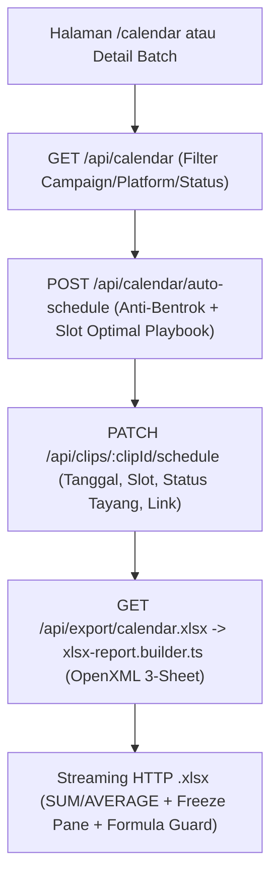

# Campaign Content Calendar & Export Laporan Excel (`.xlsx` 3-Sheet)

> **Informasi Modul**: Route: `/calendar` & tombol cepat `Export Excel (.xlsx)` di `/campaigns/:id/batches/:batchId` | Penanggung Jawab: **AhmadArifff** | Status: **`Done`** | Terakhir Diperbarui: **2026-11-28**

---

## 1. Ringkasan Eksekutif (3 Kalimat Inti)

1. **Fungsi Produk**: Menyediakan pusat jadwal publikasi konten lintas campaign (`/calendar`) lengkap dengan penjadwalan otomatis anti-bentrok berbasis jam tayang optimal Upload Playbook, pelacakan status *Belum Dijadwalkan -> Terjadwal -> Sudah Tayang*, serta ekspor laporan spreadsheet Excel `.xlsx` 3-sheet siap kirim ke klien atau tim uploader.
2. **Alur & Mesin Utama**: Backend menyimpan jadwal publikasi langsung pada kolom aditif tabel `clips` dan mengalirkan buku kerja OpenXML SpreadsheetML (`.xlsx`) secara streaming lewat `xlsx-report.builder.ts` (berbasis `ZipArchive` dari `archiver` tanpa memori `sharedStrings` besar dan kebal *Excel Formula Injection*).
3. **Dampak Nyata**: Kreator dan agensi Content Rewards dapat mengoordinasikan puluhan variasi klip lintas TikTok & YouTube tanpa jadwal tumpang tindih serta mencetak laporan rekap performa & perbandingan 6 dimensi skor viral dalam 1 klik.

---

## 2. Core Flow & Topologi Arsitektur

### Alur Kerja Normal (Happy Path)
1. User membuka menu **`Kalender & Excel`** (`/calendar`) pada navigasi utama (atau klik **`Buka Kalender`** dari halaman hasil batch) untuk melihat 4 kartu KPI (`Total Klip Siap`, `Terjadwal Tayang`, `Sudah Tayang`, `Rata-Rata Skor Viral`) beserta seluruh variasi siap tayang.
2. User dapat memfilter berdasarkan Campaign, Platform, Status Publikasi, atau `Hanya Klip Final`, lalu mengklik **`Auto-Jadwalkan Cerdas`** (`POST /api/calendar/auto-schedule`) agar klip belum terjadwal otomatis ditempatkan pada slot jam optimal dengan batas maksimal per platform per hari (anti-bentrok).
3. User dapat mengedit tanggal, slot jam, tautan postingan, catatan uploader, atau menekan 1-klik **`Tandai Tayang`** (`PATCH /api/clips/:clipId/schedule`), serta beralih antara tampilan **Kalender** dan **Tabel Matriks**.
4. User mengklik tombol Excel Pill **`Unduh Laporan Excel (.xlsx)`** (`GET /api/export/calendar.xlsx`) di `/calendar` atau **`Export Excel (.xlsx)`** di halaman batch untuk langsung mengunduh file `.xlsx` 3 worksheet (`Ringkasan Campaign`, `Kalender Upload`, `Perbandingan Variasi`).

### Diagram Alir Proses (Mermaid)

### Peta Komponen Arsitektur
- **Shared Schema**: `packages/shared/src/index.ts` (`PublishStatusSchema`, `UpdateClipScheduleInputSchema`, `AutoScheduleInputSchema`)
- **Database Prisma**: `apps/api/prisma/schema.prisma` (5 kolom jadwal pada model `Clip` + indeks `(publishStatus, scheduledAt)`)
- **Backend Excel & Calendar**: `apps/api/src/services/export/xlsx-report.builder.ts`, `apps/api/src/services/calendar.service.ts`, `apps/api/src/controllers/calendar.controller.ts`, `apps/api/src/routes/calendar.routes.ts`
- **Frontend UI**: `apps/web/pages/calendar.vue`, `apps/web/pages/campaigns/[id]/batches/[batchId].vue`, `apps/web/components/layout/StudioShell.vue`, `apps/web/composables/useThemeCopy.ts`

---

## 3. Matriks Keterlibatan Basis Data & Storage Lokal

| Tabel Prisma / Storage | Kolom / File Kunci | Tipe Aksi | Skenario Alur | Keterangan & Logika Status |
| :--- | :--- | :--- | :--- | :--- |
| `clips` | `scheduled_at`, `scheduled_slot`, `publish_status`, `published_url`, `calendar_note` | `SELECT` / `UPDATE` | **Kalender & Auto-Schedule** | Status baku English di DB (`unscheduled`, `scheduled`, `published`), ditampilkan berbahasa Indonesia di UI |
| `campaigns`, `generation_batches`, `clip_versions` | `title`, `target_config_json`, `viral_score_total`, `score_breakdown_json`, `upload_playbook_json` | `SELECT` | **Agregasi KPI & Excel 3-Sheet** | Read-only untuk menyusun 3 worksheet laporan |
| Streaming HTTP Response | `application/vnd.openxmlformats-officedocument.spreadsheetml.sheet` | `STREAM` | **Export Excel `.xlsx`** | Dialirkan langsung via `ZipArchive` tanpa meninggalkan file sementara di disk |

---

## 4. Logika Bisnis, Keamanan & Validasi Kunci

1. **Proteksi Excel Formula Injection & XML Escaping**: Fungsi `sanitizeSpreadsheetText()` mendeteksi karakter awalan berbahaya (`=`, `+`, `-`, `@`, `\t`, `\r`) pada teks input pengguna (judul, catatan, caption) dan membungkusnya dengan awalan `'` agar Excel tidak pernah mengeksekusi rumus asing, sementara `escapeXml()` membersihkan karakter kontrol ilegal.
2. **Penjadwalan Anti-Bentrok Berbasis Skor Tertinggi**: `autoScheduleClips()` memetakan jumlah klip yang sudah terjadwal pada pasangan `(tanggal, platform)`, mengurutkan klip belum terjadwal dari `viralScoreTotal DESC`, lalu menempatkannya ke slot optimal `uploadPlaybook.optimalSchedule.bestTimeSlots` maksimal `maxPerPlatformPerDay` (default `2`) per hari.
3. **Arsitektur Anti-OOM (`inlineStr` Streaming OpenXML)**: Mengadopsi prinsip `FastXlsxWriter` (`excel-export`), setiap sel string ditulis sebagai `inlineStr` dengan freeze pane header, auto column width, dan rumus agregat native `<f>SUM(...)</f>` & `<f>AVERAGE(...)</f>` pada baris total.
4. **Penolakan Export Kosong yang Ramah**: Bila filter menghasilkan `0` klip, endpoint mengembalikan HTTP `400 NO_CLIPS_FOR_EXCEL` dengan pesan bahasa Indonesia ramah alih-alih file Excel kosong.

---

## 5. Skenario Edge Cases & Celah Lapangan (*Field Edge-Case & Gap Audit*)

| No | Skenario Edge Case | Potensi Risiko Lapangan | Solusi & Penanganan Sistem |
| :---: | :--- | :--- | :--- |
| 1 | **Catatan/judul mengandung `=CMD|...` atau `& < >`** | Eksekusi formula berbahaya atau file `.xlsx` gagal dibuka karena XML rusak. | `sanitizeSpreadsheetText()` menambah prefix `'` dan `escapeXml()` mengonversi seluruh entitas XML secara ketat. |
| 2 | **Perbedaan zona waktu saat menyimpan tanggal (`YYYY-MM-DD`)** | Tanggal bergeser `-1` hari saat dikonversi UTC tengah malam. | Tanggal disimpan sebagai `T12:00:00.000Z` (tengah hari UTC) sehingga selalu konsisten di seluruh zona waktu dunia. |
| 3 | **User mengekspor Excel saat filter menghasilkan 0 klip** | Unduhan file rusak/kosong membingungkan pengguna. | UI menampilkan banner peringatan instan dan backend tetap memvalidasi `400 NO_CLIPS_FOR_EXCEL`. |

---

## 6. Checklist Pengujian & Hasil yang Diharapkan (Smoke Test)

| ID Uji | Skenario Uji | Input Data | Hasil UI yang Diharapkan | Hasil DB / Media yang Diharapkan |
| :--- | :--- | :--- | :--- | :--- |
| `TC-01` | Auto-Schedule anti-bentrok (`maxPerPlatformPerDay: 1`) untuk 2 klip | `POST /api/calendar/auto-schedule` | Toast `Berhasil menjadwalkan otomatis 2 variasi klip`, klip tampil pada 2 grup tanggal berurutan | `clips.scheduled_at` terisi `2026-12-01` & `2026-12-02`, `publish_status = 'scheduled'` |
| `TC-02` | Tandai Sudah Tayang + catatan bermuatan formula | `PATCH /api/clips/:id/schedule` | Badge berubah hijau `Sudah Tayang`, KPI `Sudah Tayang` bertambah `+1` | `publish_status = 'published'`, `published_url` & `calendar_note` tersimpan |
| `TC-03` | Export Excel `.xlsx` 3-Sheet | `GET /api/export/calendar.xlsx` | Browser mengunduh `laporan-kalender-*.xlsx` + toast sukses | Magic bytes `PK\x03\x04`, `tar -tf` memuat `sheet1.xml`, `sheet2.xml`, `sheet3.xml` lengkap dengan `<f>SUM(` & `<f>AVERAGE(` |

---

## 7. Panduan Tanya-Jawab Cepat (*Operational Q&A*)

- **Pertanyaan:** *Apa perbedaan ekspor `Bulk Streaming ZIP` (M9) dengan `Export Laporan Excel (.xlsx)` (M14)?*
  - **Jawaban:** **Bulk Streaming ZIP** mengunduh berkas media fisik siap upload (`.mp4`, `.srt`, `cover.jpg`, `upload-playbook.txt`) per folder klip, sedangkan **Laporan Excel `.xlsx`** menghasilkan buku kerja spreadsheet 3-sheet (Ringkasan KPI, Kalender Upload, dan Matriks Perbandingan 6 Dimensi Skor) untuk manajemen jadwal harian dan pelaporan klien/agensi.

---

## 8. Riwayat Perubahan (*Changelog*)

| Tanggal | Commit Hash | Pengembang | Milestone | Ringkasan Perubahan & Dampak |
| :--- | :--- | :--- | :--- | :--- |
| 2026-11-28 | `HEAD` | AhmadArifff | **M14 (V2)** | Penambahan 5 kolom jadwal pada model `Clip`, OpenXML builder 3-sheet `xlsx-report.builder.ts`, API kalender & auto-schedule (`calendar.*`), halaman `/calendar` (mode Kalender & Tabel Matriks pada 3 tema + mobile), serta tombol Excel Pill di halaman Detail Batch. |

---

## 9. Peta Alur & Flow Testing Per-Konten UI

### 9A. Matriks Keterlacakan Per-Konten

| No | Elemen UI & File Vue | Composable / Client | Endpoint HTTP | Rantai Fungsi Backend | Tabel DB / Storage Terdampak |
| :---: | :--- | :--- | :--- | :--- | :--- |
| **1** | **KPI Strip & Daftar/Tabel Kalender** `apps/web/pages/calendar.vue` | `apiRequest('/api/calendar?...')` | `GET /api/calendar` | `calendarController.overview` -> `calendarService.getCalendarOverview` | `campaigns`, `generation_batches`, `clips`, `clip_versions` (`SELECT`) |
| **2** | **Tombol Auto-Jadwalkan Cerdas** `apps/web/pages/calendar.vue` | `apiRequest('/api/calendar/auto-schedule')` | `POST /api/calendar/auto-schedule` | `calendarController.autoSchedule` -> `calendarService.autoScheduleClips` | `clips` (`UPDATE` dalam `$transaction`) |
| **3** | **Tombol Simpan Jadwal & Tandai Tayang** `apps/web/pages/calendar.vue` | `apiRequest('/api/clips/:clipId/schedule')` | `PATCH /api/clips/:clipId/schedule` | `calendarController.updateSchedule` -> `calendarService.updateClipSchedule` | `clips` (`UPDATE`) |
| **4** | **Tombol Excel Pill (`.xlsx`)** `apps/web/pages/calendar.vue` & `[batchId].vue` | `fetch('/api/export/calendar.xlsx?...')` -> Blob | `GET /api/export/calendar.xlsx` | `calendarController.exportExcel` -> `calendarService.prepareExcelExport` -> `streamXlsxWorkbook` | Streaming OpenXML `.xlsx` 3-sheet |

### 9B. Flow Testing Per-Konten dengan Ilustrasi Data Kasar

#### Konten 1: Auto-Schedule -> Tandai Tayang -> Tabel Matriks -> Export Excel `.xlsx`
- **Kondisi Awal di Layar:** Batch selesai menghasilkan 2 variasi klip siap tayang.
- **Langkah Uji:** Di halaman Batch klik **`Export Excel (.xlsx)`** -> klik **`Buka Kalender`** -> klik **`Auto-Jadwalkan Cerdas`** -> klik **`Tandai Tayang`** pada klip pertama -> pindah ke mode **`Tabel Matriks`** -> klik **`Unduh Laporan Excel (.xlsx)`**.
- **Hasil UI yang Diharapkan:** Kedua file `.xlsx` terunduh bersih, 2 klip terjadwal otomatis, klip pertama menampilkan badge `Sudah Tayang`, dan mobile `390px` bebas overflow.
- **Hasil DB / Media yang Diharapkan:** Status jadwal tersimpan di `clips` dan file `.xlsx` lolos pemeriksaan struktur OpenXML 3-sheet.

---

## 10. Disambiguasi Fitur Kembar & Batas Konteks Lintas-Menu

| Topik / Fitur Mirip | Yang Ditangani di Modul INI (Kalender & Excel - M14) | Yang Berada di Modul LAIN | Perbedaan Kunci |
| :--- | :--- | :--- | :--- |
| **Jadwal Tayang Optimal** | Mengubah rekomendasi jadwal Playbook menjadi tanggal kalender riil yang persisten di database, dapat diedit, ditandai *Sudah Tayang*, dan diekspor ke `.xlsx`. | Upload Playbook (`M7`) hanya menyajikan rekomendasi hari & slot jam generik per klip. | M14 mengelola jadwal operasional lintas campaign dan pelaporan spreadsheet. |
| **Export Paket Batch** | Menghasilkan laporan spreadsheet `.xlsx` 3-sheet (KPI, Kalender, Matriks Skor). | Bulk Streaming ZIP (`M9`) mengunduh berkas media fisik `.mp4`, `.srt`, `cover.jpg`, dan `.txt`. | Keduanya saling melengkapi pada panel Export di halaman Batch. |

- **Batas Tanggung Jawab Modul Ini:**
  - **BERTANGGUNG JAWAB ATAS:** Penjadwalan konten lintas campaign, penjadwalan otomatis anti-bentrok, pelacakan status publikasi, dan streaming laporan Excel `.xlsx` 3-sheet.
  - **TIDAK MENANGANI:** Pengeditan fisik video/subtitle (`M6`/`M8`/`M12`/`M13`) maupun pengemasan video `.mp4` ke arsip ZIP (`M9`).
