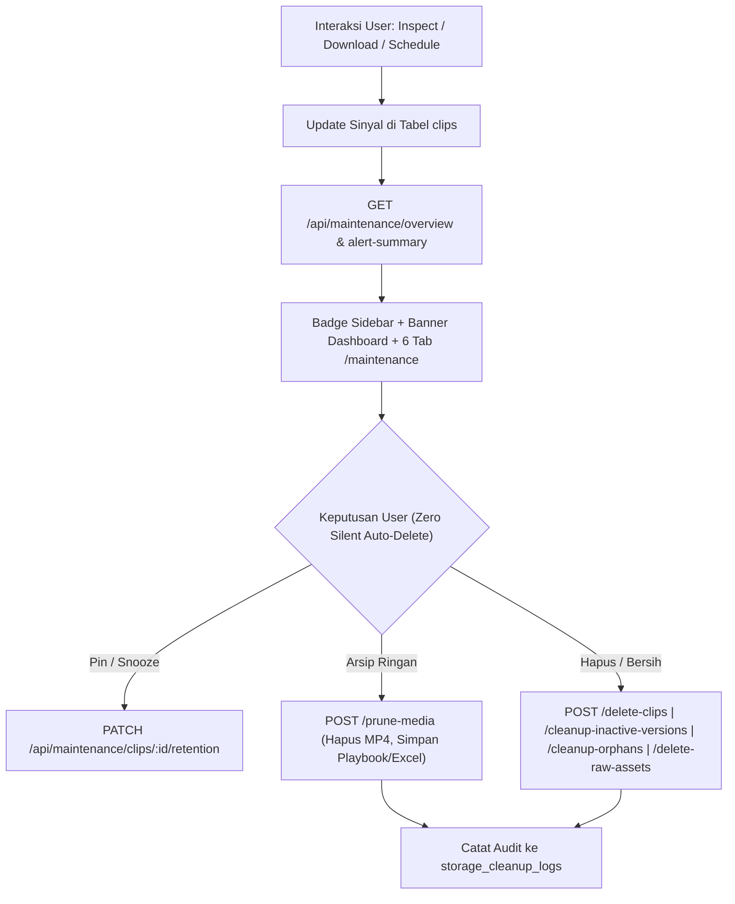

# Storage Maintenance, Lifecycle Retention & Content Hygiene Center

> **Informasi Modul**: Route: `/maintenance` (+ Badge Alert di `StudioShell.vue` & Banner di `/campaigns`) | Penanggung Jawab: **AhmadArifff** | Status: **`Done`** | Terakhir Diperbarui: **2026-11-28**

---

## 1. Ringkasan Eksekutif (3 Kalimat Inti)

1. **Fungsi Produk**: Menyediakan pusat kendali pemeliharaan penyimpanan lokal (`/maintenance`) untuk memantau kapasitas folder `storage/`, mendeteksi klip menganggur yang sudah `>= 30 hari` (peringatan dini `14 hari`) tanpa dicek maupun dijadwalkan upload, serta menyediakan aksi pembersihan aman yang terukur.
2. **Alur & Mesin Utama**: Backend melacak sinyal interaksi nyata (`lastInspectedAt`, `downloadCount`, `lastDownloadedAt`), memindai disk lokal (`uploads/`, `renders/`, `temp/`, `DB`, versi non-aktif, orphan files, render gagal), dan mengeksekusi **Arsip Ringan** (hapus MP4 saja, pertahankan Skor/Playbook/Kalender/Excel) maupun penghapusan permanen dengan kunci anti-bentrok `409` serta audit log `storage_cleanup_logs`.
3. **Dampak Nyata**: SSD laptop/PC kreator tidak menumpuk bergiga-giga oleh klip yang terlupa, versi percobaan lama, maupun raw footage campaign kedaluwarsa, namun histori performa, Upload Playbook, Kalender, dan Laporan Excel tetap aman 100% di bawah kebijakan **Zero Silent Auto-Delete**.

---

## 2. Core Flow & Topologi Arsitektur

### Alur Kerja Normal (Happy Path)
1. Saat user membuka halaman studio mana pun, `StudioShell.vue` memanggil `GET /api/maintenance/alert-summary` secara ringan dan menampilkan badge angka merah/kuning pada menu **Maintenance** bila ada klip melewati ambang retensi atau disk melewati batas peringatan.
2. User membuka `/maintenance` (`GET /api/maintenance/overview`) untuk melihat 4 KPI kapasitas, bar distribusi folder, banner peringatan proaktif, dan 6 tab pemeliharaan (*Perlu Keputusan*, *Sudah Tayang*, *Versi Lama*, *Raw Video*, *Sampah & Orphan*, *Dilindungi & Log*).
3. Pada setiap klip menganggur, user dapat memilih **Cek** (`/clips/:id`), **Jadwalkan** (`/calendar`), **Lindungi (Pin)**, **Snooze 30 Hari**, **Arsip Ringan (Hapus MP4)**, atau **Hapus Permanen** melalui modal konfirmasi Dry-Run perkiraan MB.
4. Seluruh aksi pembersihan memvalidasi ketiadaan job render aktif (`409 RENDER_IN_PROGRESS`), menghapus file dalam batas `resolveSafeStoragePath()`, dan mencatat hasil penghematan ke `storage_cleanup_logs`.

### Diagram Alir Proses (Mermaid)

### Peta Komponen Arsitektur
- **Frontend Pages & Layout**: `apps/web/pages/maintenance.vue`, `apps/web/components/layout/StudioShell.vue`, `apps/web/pages/campaigns/index.vue`, `apps/web/pages/clips/[clipId].vue`
- **Backend Routes & Controller**: `apps/api/src/routes/maintenance.routes.ts`, `apps/api/src/controllers/maintenance.controller.ts`
- **Backend Services**: `apps/api/src/services/maintenance.service.ts`, `apps/api/src/services/clip.service.ts` (tracking `lastInspectedAt`), `apps/api/src/services/export.service.ts` (tracking `downloadCount`)
- **Shared Zod Contracts**: `RetentionPolicyConfigSchema`, `UpdateRetentionPolicyInputSchema`, `ClipRetentionActionInputSchema`, `MaintenanceBulkClipsInputSchema`, `MaintenanceDeleteRawAssetsInputSchema` di `packages/shared/src/index.ts`

---

## 3. Matriks Keterlibatan Basis Data & Storage Lokal

| Tabel Prisma / Storage | Kolom / File Kunci | Tipe Aksi | Skenario Alur | Keterangan & Logika Status |
| :--- | :--- | :--- | :--- | :--- |
| `clips` | `last_inspected_at`, `last_downloaded_at`, `download_count`, `retention_protected`, `snoozed_until`, `media_pruned_at` | `SELECT` / `UPDATE` / `DELETE` | **Core Flow** | Melacak interaksi nyata, proteksi Pin/Snooze, dan penanda Arsip Ringan |
| `clip_versions` | `output_video_path`, `output_ass_path`, `output_srt_path`, `cover_image_path` | `SELECT` / `UPDATE` | **Core Flow** | Mengosongkan path MP4/ASS/SRT saat Arsip Ringan sambil mempertahankan skor & Playbook |
| `master_presets` | `category='retention_policy'`, `code='default_policy' / 'user_<id>'` | `SELECT` / `UPSERT` | **Core Flow** | Menyimpan ambang hari & batas peringatan disk secara dinamis tanpa hardcode |
| `storage_cleanup_logs` | `action_type`, `items_affected`, `freed_bytes`, `summary` | `INSERT` / `SELECT` | **Core Flow** | Audit histori penghematan ruang disk sepanjang waktu |
| `storage/uploads/`, `renders/`, `temp/` | Berkas `.mp4`, `.ass`, `.srt`, temp/orphan | `STAT` / `DELETE` | **Core Flow** | Tervalidasi ketat lewat `resolveSafeStoragePath()` |

---

## 4. Logika Bisnis, Keamanan & Validasi Kunci

1. **Zero Silent Auto-Delete Policy**: Tidak pernah menghapus file media secara otomatis di background tanpa konfirmasi eksplisit pengguna (wajib melewati modal Dry-Run preview MB).
2. **Proteksi Konkurensi Render (`409 RENDER_IN_PROGRESS`)**: Seluruh endpoint pembersihan disk menolak eksekusi apabila masih ada baris `render_jobs` berstatus `queued` atau `processing`.
3. **Arsip Ringan Non-Destruktif (`prune-media`)**: Menghapus file MP4/ASS/SRT besar namun mempertahankan `cover.jpg`, `viralScoreTotal`, `uploadPlaybookJson`, jadwal Kalender (`M14`), dan ekspor Excel `.xlsx` agar histori laporan bisnis tetap utuh.
4. **Isolasi Kepemilikan Data (IDOR Guard) & Path Traversal Guard**: Seluruh mutasi memverifikasi `campaign.userId === req.user.sub` dan semua operasi disk wajib melalui `resolveSafeStoragePath()`.

---

## 5. Skenario Edge Cases & Celah Lapangan (*Field Edge-Case & Gap Audit*)

| No | Skenario Edge Case | Potensi Risiko Lapangan | Solusi & Penanganan Sistem |
| :-: | :--- | :--- | :--- |
| 1 | **Klip menganggur >= 30 hari tidak pernah dibuka/dijadwalkan** | File MP4 mati menumpuk di laptop tanpa disadari. | Terdeteksi otomatis di Tab *Perlu Keputusan* + badge merah di sidebar dengan pilihan Cek, Jadwalkan, Pin, Snooze, Arsip MP4, atau Hapus Permanen. |
| 2 | **Klip evergreen sengaja disimpan untuk bulan depan** | Terhapus tidak sengaja saat bersih-bersih massal. | Fitur **Lindungi (Pin)** (`retentionProtected = true`) & **Snooze 30 Hari** mengeluarkan klip dari daftar peringatan & seleksi massal. |
| 3 | **Klip sudah tayang, MP4 ingin dihapus tapi laporan Excel masih butuh data** | Jika baris klip dihapus permanen, statistik & riwayat Excel ikut hilang. | Fitur **Arsip Ringan** menghapus MP4 saja (`mediaPrunedAt` terisi), halaman Clip Inspector tetap menampilkan Playbook & Skor dengan pemberitahuan ramah. |
| 4 | **Menghapus video mentah (`raw_video`) pada campaign yang masih diedit** | Prompt Re-Editor & Visual Timeline tidak punya sumber video lagi. | Tab *Raw Video* menampilkan peringatan eksplisit dan hanya memberi lencana *"Disarankan Hapus"* pada campaign yang selesai/lewat deadline/diarsipkan. |
| 5 | **User menekan Bersihkan Sampah saat FFmpeg sedang merender batch** | Menghapus file temp yang sedang dipakai FFmpeg sehingga render korup. | Guard `assertNoActiveRenderJobs()` langsung mengembalikan HTTP `409 RENDER_IN_PROGRESS`. |

---

## 6. Checklist Pengujian & Hasil yang Diharapkan (Smoke Test)

| ID Uji | Skenario Uji | Input Data | Hasil UI yang Diharapkan | Hasil DB / Disk yang Diharapkan |
| :--- | :--- | :--- | :--- | :--- |
| `TC-01` | Deteksi klip menganggur 35 hari + Pin/Snooze | Klip backdated 35 hari belum dicek & unscheduled | Muncul di Tab *Perlu Keputusan* (`Kritis 35 Hari`) & badge merah di sidebar; hilang setelah klik *Lindungi* / *Snooze 30h* | `retention_protected = true` / `snoozed_until > now` |
| `TC-02` | Arsip Ringan (`prune-media`) | Klip hasil render dengan MP4 fisik valid | Modal Dry-Run MB -> sukses, ruang disk berkurang, Clip Inspector tetap menampilkan Skor & Playbook | File `.mp4/.ass/.srt` terhapus dari disk, `cover.jpg` + `upload_playbook_json` utuh, tercatat di `storage_cleanup_logs` |
| `TC-03` | Proteksi `409` saat render berjalan | `render_jobs` aktif berstatus `processing` | Pesan peringatan bahwa pembersihan dikunci sementara | API mengembalikan HTTP `409 RENDER_IN_PROGRESS` tanpa menghapus file |

---

## 7. Panduan Tanya-Jawab Cepat (*Operational Q&A*)

- **Pertanyaan:** *Apakah klip yang melewati 30 hari otomatis terhapus sendiri?*
  - **Jawaban:** Tidak. Sistem mematuhi kebijakan **Zero Silent Auto-Delete** sehingga hanya menyalakan peringatan & badge notifikasi agar Anda sendiri yang memutuskan (Jadwalkan, Pin, Snooze, Arsip Ringan, atau Hapus Permanen).
- **Pertanyaan:** *Apa bedanya Arsip Ringan vs Hapus Permanen?*
  - **Jawaban:** **Arsip Ringan** hanya menghapus file MP4/subtitle besar di disk namun tetap menyimpan Skor Viral, Upload Playbook, link tayang, Kalender, dan Laporan Excel; sedangkan **Hapus Permanen** menghapus seluruh file fisik dan catatan klip dari database.

---

## 8. Riwayat Perubahan (*Changelog*)

| Tanggal | Commit Hash | Pengembang | Milestone | Ringkasan Perubahan & Dampak |
| :--- | :--- | :--- | :---: | :--- |
| 2026-11-28 | `HEAD` | AhmadArifff | **M18** | Implementasi Storage Maintenance, Lifecycle Retention Policy dinamis, Tracking Interaksi (`lastInspectedAt`/`downloadCount`), Arsip Ringan, Orphan/Version/Raw Cleanup, Badge Sidebar + Banner Dashboard, & `StorageCleanupLog`. |

---

## 9. Peta Alur & Flow Testing Per-Konten UI

### 9A. Matriks Keterlacakan Per-Konten

| No | Elemen UI & File Vue | Composable / Client | Endpoint HTTP | Rantai Fungsi Backend | Tabel DB / Storage Terdampak |
| :-: | :--- | :--- | :--- | :--- | :--- |
| **1** | **Badge Alert Sidebar & Banner Dashboard** `StudioShell.vue`, `pages/campaigns/index.vue` | `apiRequest('/api/maintenance/alert-summary')` | `GET /api/maintenance/alert-summary` | `maintenanceController.alertSummary` -> `maintenanceService.getAlertSummary` | `clips`, `master_presets`, `storage/` (`SELECT`) |
| **2** | **Panel Aturan Retensi (7/14/30/60h & Kuota Disk)** `pages/maintenance.vue` | `apiRequest('/api/maintenance/policy')` | `PATCH /api/maintenance/policy` | `maintenanceController.updatePolicy` -> `maintenanceService.updatePolicy` | `master_presets` (`UPSERT`) |
| **3** | **Aksi Pin / Snooze & Arsip Ringan / Hapus** `pages/maintenance.vue` | `apiRequest('/api/maintenance/...')` | `PATCH /clips/:id/retention`, `POST /actions/prune-media`, `/delete-clips`, `/cleanup-inactive-versions`, `/cleanup-orphans`, `/delete-raw-assets` | `maintenanceController.*` -> `maintenanceService.*` | `clips`, `clip_versions`, `media_assets`, `storage_cleanup_logs`, `storage/` |

### 9B. Flow Testing Per-Konten dengan Ilustrasi Data Kasar

#### Konten 1: Arsip Ringan Klip Menganggur 35 Hari
- **Kondisi Awal di Layar:** Terdapat 1 klip berusia 35 hari (`Belum Pernah Dicek | Belum Dijadwalkan`) dengan file `video.mp4` di disk.
- **Langkah Uji:** Buka `/maintenance` -> pastikan badge & kartu KPI menampilkan `1 klip` kritis -> klik **`Arsip MP4`** -> baca Dry-Run MB pada modal konfirmasi -> klik **`Ya, Lanjutkan`**.
- **Hasil UI yang Diharapkan:** Banner hijau mengonfirmasi ruang MB yang dibebaskan, klip berpindah dari daftar menganggur, Log Pembersihan bertambah 1 baris, dan saat membuka `/clips/:clipId` tampil informasi *Media MP4 Diarsipkan Ringan* dengan Skor Viral & Playbook tetap lengkap.
- **Hasil DB / Disk yang Diharapkan:** File fisik `.mp4/.ass/.srt` terhapus, `clips.media_pruned_at` terisi, `storage_cleanup_logs` bertambah 1 record.

---

## 10. Disambiguasi Fitur Kembar & Batas Konteks Lintas-Menu

| Topik / Fitur Mirip | Yang Ditangani di Modul INI (`/maintenance`) | Yang Berada di Modul LAIN | Perbedaan Kunci |
| :--- | :--- | :--- | :--- |
| **Pembersihan Disk Lokal** | Pusat komprehensif 6 kategori (Retensi 30 hari, Arsip Ringan, Versi Lama, Raw Video, Orphan/Gagal, Kebijakan Dinamis & Audit Log). | Tombol cepat *"Bersihkan File Sementara"* di `DoctorPanel.vue` (`/settings/api-keys`, `M9`). | `DoctorPanel` hanya pembersihan cepat `storage/temp`; `/maintenance` mengelola seluruh siklus hidup media & retensi konten. |
| **Jadwal Publikasi Klip** | Membaca `publishStatus` untuk memberi peringatan klip belum dijadwalkan & tautan cepat ke Kalender. | Penjadwalan tanggal, Auto-Jadwalkan, & Ekspor Excel (`.xlsx`) di `/calendar` (`M14`). | `/maintenance` memantau retensi & kapasitas file; `/calendar` mengatur penjadwalan & ekspor laporan. |

- **Batas Tanggung Jawab Modul Ini:**
  - **BERTANGGUNG JAWAB ATAS:** Pemantauan kapasitas penyimpanan lokal, deteksi klip menganggur lintas ambang hari, pelacakan interaksi klip, proteksi Pin/Snooze, Arsip Ringan MP4, pembersihan versi lama/orphan/raw, dan audit log pembersihan.
  - **TIDAK MENANGANI:** Rendering video FFmpeg (`M6`/`M8`), penjadwalan tanggal upload (`M14`), maupun pengaturan kunci API BYOK (`M4`).
