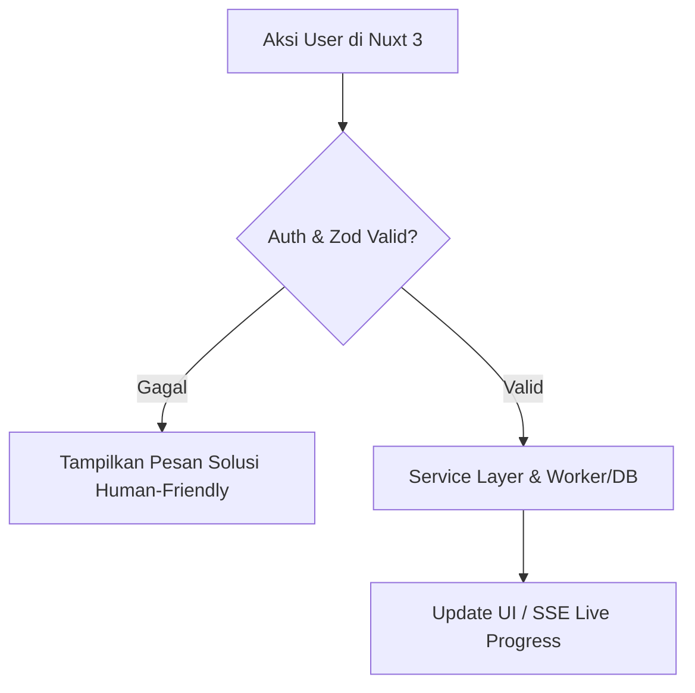

# [Nama Menu / Modul Resmi]

> **Informasi Modul**: Route: `[route]` | Penanggung Jawab: **AhmadArifff** | Status: **`[Status]`** | Terakhir Diperbarui: **[Tanggal]** (Commit: `[Hash]`)

---

## 1. Ringkasan Eksekutif (3 Kalimat Inti)

1. **Fungsi Produk**: [Jelaskan 1 kalimat peran modul ini bagi kreator Content Rewards].
2. **Alur & Mesin Utama**: [Jelaskan 1 kalimat data/media/AI apa yang diproses dan validasi kuncinya].
3. **Dampak Nyata**: [Jelaskan 1 kalimat efisiensi waktu, peningkatan peluang viral, atau pencegahan pelanggaran brief].

---

## 2. Core Flow & Topologi Arsitektur

### Alur Kerja Normal (Happy Path)
1. **Langkah 1**: [Aksi pengguna pada UI Nuxt 3].
2. **Langkah 2**: [Validasi form client + pengiriman request relative path `/api/...`].
3. **Langkah 3**: [Auth guard + Zod validation + Service layer mengembalikan `ServiceResult<T>`].
4. **Langkah 4**: [Operasi Prisma SQLite / BYOK AI Adapter / Local FFmpeg Worker].
5. **Langkah 5**: [Umpan balik ke UI: Toast, update Pinia/Vue Query, atau stream progress SSE].

### Diagram Alir Proses (Mermaid)

### Peta Komponen Arsitektur
- **Frontend Page**: `client/pages/...`
- **Frontend Components / Store**: `client/components/...`, `client/stores/...`
- **API Route & Controller**: `server/routes/...`, `server/controllers/...`
- **Zod Schema**: `server/schemas/...`
- **Service & Repository/Adapter**: `server/services/...`, `server/repositories/...`
- **Worker / Media Engine (Jika Ada)**: `server/workers/...`, `server/services/media/...`

---

## 3. Matriks Keterlibatan Basis Data & Storage Lokal

| Tabel Prisma / Direktori Storage | Kolom / File Kunci | Tipe Aksi | Skenario Alur | Keterangan & Logika Status |
| :--- | :--- | :--- | :--- | :--- |
| `[nama_tabel]` | `[kolom_1]`, `[kolom_2]` | `INSERT` | **Core Flow** | [Pembuatan entitas baru] |
| `[nama_tabel]` | `status`, `updated_at` | `UPDATE` | **Core Flow** | [Transisi status normal] |
| `storage/[folder]/` | `[uuid].[ext]` | `WRITE` | **Core Flow** | [Penyimpanan file media lokal] |

---

## 4. Logika Bisnis, Keamanan & Validasi Kunci

1. **Auth & Proteksi Rahasia**: [Pastikan route terlindungi auth guard; masking jika terkait API Key].
2. **Validasi Zod & Guardrail**: [Skema input HTTP dan skema output AI / clamp durasi FFprobe].
3. **Penanganan Concurrency / Transaksi**: [Batas worker FFmpeg / transaksi Prisma / retry parsial].

---

## 5. Skenario Edge Cases & Celah Lapangan (*Field Edge-Case & Gap Audit*)

| No | Skenario Edge Case | Potensi Risiko Lapangan | Solusi & Penanganan Sistem |
| :---: | :--- | :--- | :--- |
| 1 | **[Kasus 1]** | [Risiko] | [Mitigasi sistematis] |
| 2 | **[Kasus 2]** | [Risiko] | [Mitigasi sistematis] |
| 3 | **[Kasus 3]** | [Risiko] | [Mitigasi sistematis] |

---

## 6. Checklist Pengujian & Hasil yang Diharapkan (Smoke Test)

| ID Uji | Skenario Uji | Input Data | Hasil UI yang Diharapkan | Hasil DB / File Media yang Diharapkan |
| :--- | :--- | :--- | :--- | :--- |
| `TC-01` | Happy Path | [Data uji valid] | [Respon sukses / progress selesai] | [Row Prisma & file media valid] |
| `TC-02` | Validasi / Error | [Data invalid / API error] | [Pesan ramah + tombol retry] | [Tidak ada data korup / file yatim] |

---

## 7. Panduan Tanya-Jawab Cepat (*Operational Q&A*)

- **Pertanyaan:** *[Pertanyaan operasional yang sering muncul di lapangan]?*
  - **Jawaban:** *[Jawaban ringkas dan praktis].*

---

## 8. Riwayat Perubahan (*Changelog*)

| Tanggal | Commit Hash | Pengembang | Milestone | Ringkasan Perubahan & Dampak |
| :--- | :--- | :--- | :--- | :--- |
| YYYY-MM-DD | `hash` | AhmadArifff | **M[X]** | [Rincian perubahan] |

---

## 9. Peta Alur & Flow Testing Per-Konten UI (*Button, Form, Modal & Player*)

### 9A. Matriks Keterlacakan Per-Konten (*UI Element -> Composable/API -> Backend Call Chain -> DB/Storage*)

| No | Elemen UI & File Vue | Composable / API Client | Endpoint HTTP | Rantai Fungsi Backend | Tabel DB / Storage Terdampak |
| :---: | :--- | :--- | :--- | :--- | :--- |
| **1** | **[Nama Elemen]** File: `client/...` | `useXxx()` File: `client/services/...` | `POST /api/...` | `XxxController -> XxxService -> XxxRepository` | `[tabel]` (`INSERT/UPDATE`) |

### 9B. Flow Testing Per-Konten dengan Ilustrasi Data Kasar

#### Konten 1: [Nama Form / Tombol / Player]
- **Kondisi Awal di Layar:** [Deskripsi data contoh].
- **Langkah Uji:**
  1. Buka `/[route]`.
  2. Isi input `[field = "..."]`.
  3. Klik tombol `[Nama Tombol]`.
- **Hasil UI yang Diharapkan:** [Status loading -> sukses -> perubahan tampilan].
- **Hasil DB / File yang Diharapkan:** [Baris baru / update kolom / hasil `ffprobe`].

---

## 10. Disambiguasi Fitur Kembar & Batas Konteks Lintas-Menu (*Context Boundary Guard*)

| Topik / Fitur Mirip | Yang Ditangani di Modul INI (`[route]`) | Yang Berada di Modul LAIN (Jangan Tertukar!) | Perbedaan Kunci |
| :--- | :--- | :--- | :--- |
| **[Contoh: Pengaturan Audio]** | [Konteks di modul ini] | [Konteks di modul lain] | [Endpoint / tabel / cakupan] |

- **Batas Tanggung Jawab Modul Ini:**
  - **BERTANGGUNG JAWAB ATAS:** [Daftar singkat 2-3 tanggung jawab inti].
  - **TIDAK MENANGANI:** [Daftar tegas cakupan modul lain].
